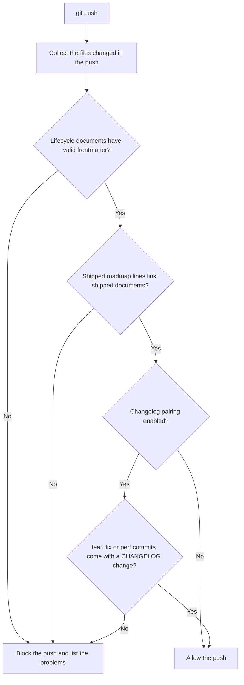
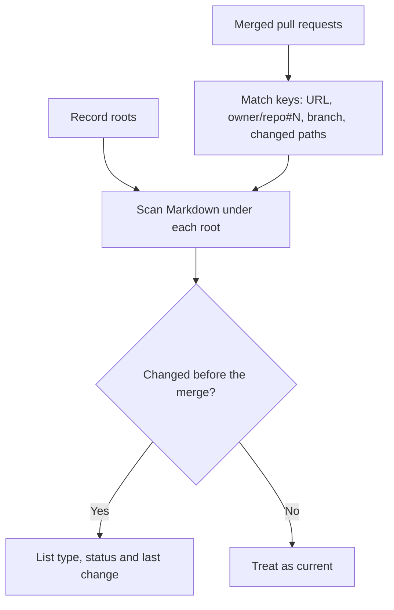

# drift-guard

Drift guard keeps a project's tracking records honest. It blocks a push when documents are missing required metadata or when the roadmap claims something shipped that its design does not. After a merge, it reports branches and worktrees that the merge left behind, and working-memory records that the merge may have made out of date.

It has three parts:

| File | Runs | Role |
|---|---|---|
| `pre-push` | On `git push` | Runs `housekeep check --push` on the commits being pushed and blocks the push if it finds a problem |
| `post-merge` | After `git pull` or `git merge` | Runs `housekeep check` and reports what the merge left behind. Never blocks. |
| `housekeep` | Called by the hooks, or by hand | Does the checking and, in `fix` mode, the cleanup |

## What the push check enforces

| Check | Applies to | Rule |
|---|---|---|
| Lifecycle frontmatter | Markdown files in the push under `0-brainstorms/`, `1-discovery/`, `2-design/`, `3-plans/`, `4-reviews/`, the target `1-research/`, `2-requirements/`, `3-design/`, `4-plans/`, `5-reviews/`, `6-retros/`, or `adrs/`, plus standalone `6-retros/lessons/<workstream>/*.md` | The file must start with a YAML frontmatter block containing `title`, `type` and `authors`. Lifecycle documents use `created`, `updated` and `status`. Dates must be valid `YYYY-MM-DD` values with `updated` on or after `created`. Legacy `date` remains accepted when `created` is absent; both creation fields must agree when present together. `status` must be one of `draft`, `approved`, `in-progress`, `shipped`, `resolved`, `superseded`, `open`, `parked`, or `abandoned`. Local paths in `related`, `supersedes` and `superseded_by` must resolve relative to the file's own directory. |
| Shipped roadmap lines | Lines added under `Recently shipped` in `ROADMAP.md` that link to lifecycle documents | Each linked document must have `status: shipped`. |
| Changelog pairing (opt-in) | Pushes containing `feat`, `fix` or `perf` commits | The push must also change `CHANGELOG.md`. Turn this on by creating `scripts/githooks/drift-guard.on`. |



The lifecycle types include `requirements`, `lesson`, and `analysis`, with historical `discovery` retained. Nested standalone lessons are checked; raw bundle contents and assets remain exempt. A lesson can stay `draft` without representing incomplete delivery work.

Preview and apply metadata migration with the [frontmatter migration script](../../scripts/migrate-frontmatter.py), following the [migration procedure](../../guides/guide-project-structure-and-conventions.md#102-folder-renames). Deploy the compatible hook first. The check validates supported fields and does not parse all YAML syntax.

## Modes

| Mode | What it looks at | Uses the network | Exit code | Called by |
|---|---|---|---|---|
| `check --push <base> <head>` | Frontmatter, roadmap pairing and changelog pairing for the pushed commits | Never | `1` if it finds a problem | `pre-push` |
| `check` | The last pull (`ORIG_HEAD..HEAD`) and stale branches | Yes | Always `0` | `post-merge` |
| `audit` | Every local branch and registered worktree | Yes | Always `0` | `/housekeeping audit` |
| `fix` | Removes what `audit` marked safe to remove | Yes | Always `0` | `/housekeeping fix` |
| `records <n>...` | Working-memory records that refer to the named merged pull requests | Yes, for branch names | Always `0` | `/housekeeping records`, or by hand after edits or a merge with no local pull |

## Reading the audit output

`housekeep audit` prints a scope line, one line per branch and noteworthy worktree, and a summary.

### Scope line

```
  audit <owner/repo> at <toplevel>: <Nb> branches (<P> protected), <Mw> worktrees, <K> pull requests resolved, <J> unresolved
```

If `origin` is missing or is not a GitHub URL, pull request state cannot be looked up:

```
  audit <toplevel>: no GitHub identity (origin missing or unparseable); pull-request state unresolved for all <N> branches
```

### Branch lines

```
  branch <B>: pull request #<N> merged, safe to remove
    worktree <path> holds it, so remove that first
  branch <B>: pull request #<N> merged, local behind its head, safe to remove
  branch <B>: pull request #<N> open, kept
  branch <B>: pull request #<N> closed unmerged, kept
  branch <B>: commits past pull request #<N> (<state>), kept
  branch <B>: merged pull request #<N>, but <oid12> is not in <base> history, kept
  branch <B>: diverged from pull request #<N> head, kept
  branch <B>: no pull request found, kept
  branch <B>: pull request #<N> merged, worktree <path> <blocker>, kept
  branch <B>: checked out in the main worktree, kept
  branch <B>: unresolved (<reason>), kept
```

`<blocker>` is the worktree state that prevents removal: `has uncommitted changes`, `is locked` or `holds ignored files`.

### Worktree lines

```
  worktree <path> (<B>): uncommitted changes, kept
  worktree <path> (<B>): locked (<reason>), kept
  worktree <path> (<B>): ignored files (<n>: <p1>, <p2>, ...), kept
  worktree <path>: detached HEAD, not managed
  worktree <path>: directory missing, metadata prunable
```

The main worktree is counted in the scope line but never listed.

### Summary line

```
  <R> removable, <K> kept, <J> unresolved, across <Nb> branches and <Mw> worktrees
  housekeep fix
```

The `housekeep fix` hint appears only when something is removable.

## What the merge check lists in working-memory records

A merge can make a record false without touching it: a research note that says "not applied" after the fix shipped. `check` and `records` list each record that refers to a merged pull request and last changed before the merge. They read local files and print. Deciding whether a listed record is still true is left to you or your agent.



### Where it looks

The record roots are the union of the first two sources. The third is used only when both give nothing. The output names the source of each root.

| Order | Source | Example |
|---|---|---|
| 1 | `git config --add housekeep.recordRoot <path>`, repeatable, per clone | `records`, `.docs` |
| 2 | The `Working memory` line of the Project Map in `CLAUDE.md`, `AGENTS.md` or `GEMINI.md`: each backticked path, or the first word when there is none | `` - **Working memory**: `.private-docs/` `` |
| 3 | Any top-level folder, hidden or not, that holds a lifecycle folder such as `3-design/` | `docs/`, `.docs/`, `records/`, `.private-docs/` |

A root can be a folder in the same repository or a nested independent repository. `HOUSEKEEP_RECORD_ROOTS`, colon-separated, replaces all three for one run.

### What counts as a match

| Key | Example | Rule |
|---|---|---|
| Pull request URL | `github.com/owner/repo/pull/46` | The number must end there, so `pull/460` does not match `pull/46` |
| Short reference | `owner/repo#46` | Same rule |
| Head branch | `feat/mac-stay-awake` | Needs an answer from GitHub. Skipped for the default branch |
| Changed path | `scripts/mac-stay-awake.sh` | From the merge commit. `README.md`, `CHANGELOG.md`, `ROADMAP.md`, `CLAUDE.md`, `AGENTS.md` and `GEMINI.md` are skipped, and so are all paths when the merge changed more than 50 files |

A bare "PR 46" does not match, because it is ambiguous across repositories. Write the full URL into a record when its pull request opens.

A record is current when its last commit is at or after the merge commit, or when it has uncommitted edits. Files under `assets/` and `notes/pre-publication-snapshots/` are skipped. A record whose status is `shipped`, `resolved`, `superseded` or `abandoned` and that only names a changed path or the branch is skipped and counted, because it describes past work; one that links the pull request is still listed. A listed design, plan or requirements record that links the pull request and is still `draft`, `approved` or `in-progress` also shows "status not shipped". A design can span several pull requests, so treat that as a prompt.

Output:

```text
  record roots: records (Project Map)
  records older than pull request 46 (feat/mac-stay-awake):
    records/1-research/2026-11-17-notes.md  research, draft, last changed 2026-11-17: links the PR
  edit each record, or leave it when it is still true, then: housekeep records 46
```

## What it does not do, on purpose

- **No network calls during a push.** They would slow every push, fail offline, and tempt people to skip the hook with `--no-verify`.
- **No checks on Markdown outside lifecycle directories.** `notes/`, `assets/`, `imports/`, `guides/`, root files such as the README, ROADMAP and CHANGELOG, and published documentation are exempt.
- **No rule that every feature needs a roadmap line.** Measured against history, that rule was wrong 44% of the time, because many features never had a roadmap line.
- **No edits to records.** The record list is a report. A merge done on GitHub with no local pull runs no hook, so run `housekeep records <n>` after it.
- **No automatic cleanup.** `fix` removes branches and worktrees only when you run it.
- **No forced worktree removal.** It never passes `--force` to `git worktree remove`.
- **No remote branch deletion.** Turn on GitHub's "Automatically delete head branches" setting for that.

## Limitations

- **Branch names containing `"`** are not supported by the record parser. Such branches are reported as `unresolved` and kept.
- **Detached worktrees** have no branch, so `fix` never removes or changes them.
- **Ignored files** block removal. `git worktree remove` would delete them silently, so `housekeep` keeps the worktree until you clear them yourself.

## False-positive measurements

### Push frontmatter check (2026-09-04)

Run against the full history of four repositories:

| Repository | Files without frontmatter | Of those, in a lifecycle directory |
|---|---|---|
| Repository A | 22 | 0 |
| Repository B | 29 | 11 |
| Repository C | 16 | 0 |
| Repository D | 6 | 0 |

Limiting the check to lifecycle directories removed every false positive in three of the four repositories. The 11 findings in the fourth were real gaps, which were then fixed.

### Audit of branches and worktrees (2026-09-17)

Run across nine repositories, including nested private companion repositories:

| Repositories | Branches | Worktrees | Marked removable | Wrong on inspection |
|---|---|---|---|---|
| 9 | 17 | 12 | 0 | 0 |

Every open branch, branch without a pull request, and worktree with uncommitted or ignored files was kept.

## Install

```bash
hook_src=<path-to-toolkit>/git-hooks/drift-guard
target=<path-to-repo>

mkdir -p "$target/scripts/githooks"
cp "$hook_src/housekeep" "$hook_src/pre-push" "$hook_src/post-merge" "$target/scripts/githooks/"
chmod +x "$target/scripts/githooks/housekeep" "$target/scripts/githooks/pre-push" "$target/scripts/githooks/post-merge"
git -C "$target" config core.hooksPath scripts/githooks
```
