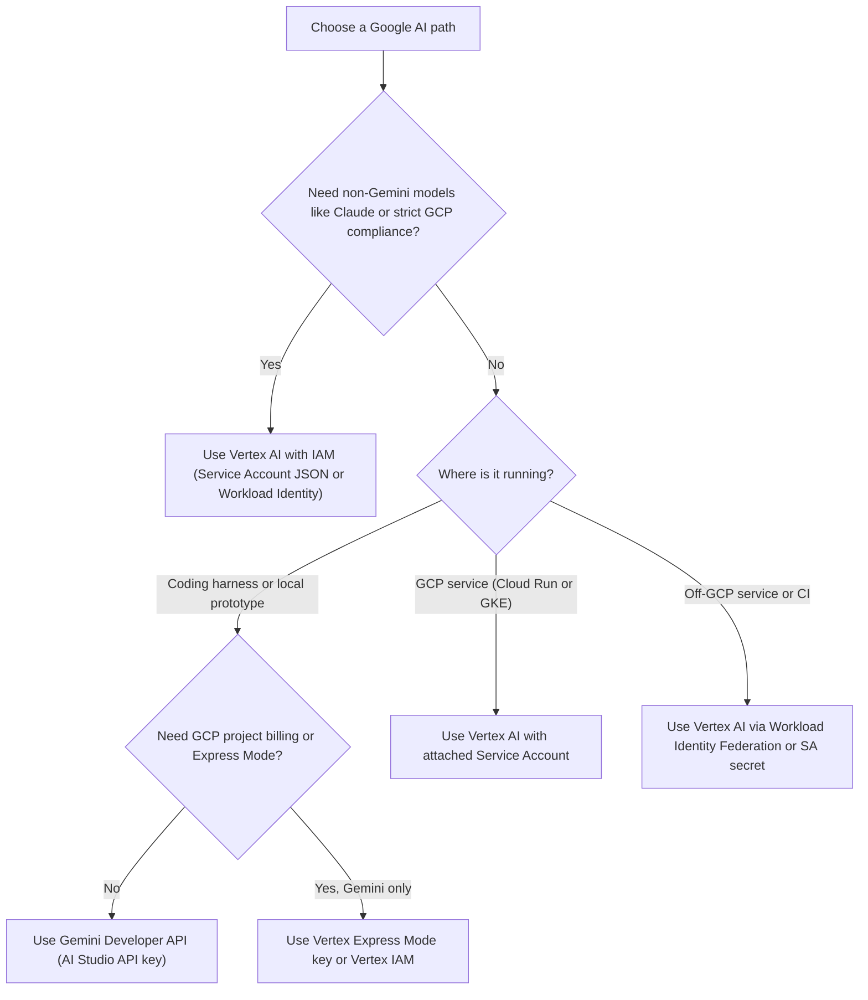

# Google Gemini API and Vertex AI for coding harnesses and agents

How to choose between the **Gemini Developer API (Google AI Studio)** and **Vertex AI (Google Cloud)**, authenticate them across AI coding harnesses and OpenCode, claim Google Cloud credits without surprises, and run standalone agents or CI/CD jobs reliably. Use this guide when setting up Gemini or Claude-on-Vertex in a coding harness, managing multiple Google accounts, or wiring Google models into your own applications.

> **One-line rule:** Use the **Gemini Developer API** (`GEMINI_API_KEY`) for fast solo setups, Free Tier testing, and Google AI Studio credits. Use **Vertex AI** (`aiplatform.googleapis.com` with Service Accounts or Workload Identity) for enterprise privacy, GCP billing isolation, and third-party Model Garden models such as Claude.



---

## 1. Gemini Developer API vs Vertex AI

Google exposes Gemini models on two separate API surfaces. Both work through Google's unified Gen AI SDKs, but they differ in authentication, billing, privacy, and available models ([Vertex SDK overview](https://docs.cloud.google.com/gemini-enterprise-agent-platform/models/sdks/overview)).

| Dimension | Gemini Developer API (Google AI Studio) | Vertex AI (`aiplatform.googleapis.com`) |
| :--- | :--- | :--- |
| **Endpoint** | `generativelanguage.googleapis.com` | `aiplatform.googleapis.com` (`global`) or `<region>-aiplatform.googleapis.com` |
| **Authentication** | API key from [Google AI Studio](https://aistudio.google.com/docs/api-key) (`GEMINI_API_KEY` / `GOOGLE_GENERATIVE_AI_API_KEY`) | GCP IAM (`gcloud` ADC, Service Account JSON, Workload Identity / OIDC), or Express Mode API key ([Express Mode docs](https://docs.cloud.google.com/gemini-enterprise-agent-platform/models/start/express-mode/overview)) |
| **Available models** | Google Gemini models only | Google Gemini models plus Model Garden partner models (such as Claude; partner models require IAM, not Express Mode keys) |
| **Billing and tiers** | Free Tier (no billing required; rate-limited) and Paid Tiers 1–3 via Cloud Billing / Prepay ([AI Studio billing](https://aistudio.google.com/docs/billing)) | Pay-as-you-go Dynamic Shared Quota (DSQ) or reserved [Provisioned Throughput](https://docs.cloud.google.com/gemini-enterprise-agent-platform/models/provisioned-throughput) |
| **Data governance** | Free Tier inputs/outputs may be used to improve Google products; Paid Tiers apply stricter non-training governance ([AI Studio billing](https://aistudio.google.com/docs/billing)) | Enterprise isolation: prompts and outputs are not used to train Google models; supports VPC-SC, regional residency, SOC 2, and HIPAA |
| **OpenCode provider** | Built-in `google` (`@ai-sdk/google`) ([AI SDK Google](https://ai-sdk.dev/providers/ai-sdk-providers/google)) | Built-in `google-vertex` (`@ai-sdk/google-vertex`) ([AI SDK Vertex](https://ai-sdk.dev/providers/ai-sdk-providers/google-vertex)) |

---

## 2. Billing, free tiers, and Google Cloud credits (checked 2026-11-16)

Credit rules differ sharply between **Google AI Pro**, **Google AI Studio**, and the **Google Cloud $300 Free Trial**. Check which pool pays for which API before creating projects.

| Credit or tier | What you get | Works for Gemini API (AI Studio) | Works for Vertex AI | Key conditions (checked 2026-11-16) |
| :--- | :--- | :--- | :--- | :--- |
| **AI Studio Free Tier** | Free rate-limited Gemini usage ([AI Studio billing](https://aistudio.google.com/docs/billing)) | Yes | No | Lower RPM/TPM limits; prompts may be used to improve Google products |
| **Google AI Pro credits** | **$10 USD/month** via the [Google Developer Program](https://developers.google.com/program) | Yes (Paid Tier) | Yes | Credits accumulate and stay valid for 12 months; AI Studio Prepay accounts require a **$5 minimum deposit** before promo credits activate, after which promo credits spend first ([AI Studio billing](https://aistudio.google.com/docs/billing)) |
| **GCP $300 Free Trial** | **$300 USD** Welcome credit for **90 days** ([Google Cloud Free](https://cloud.google.com/free)) | **No** | **No** (for trials started or upgraded on/after Nov 16, 2026) | Cannot pay for AI Studio Gemini API, partner Model-as-a-Service APIs, or Vertex AI / Gemini platform services for sign-ups or paid upgrades on or after **November 16, 2026** ([Free Cloud features](https://docs.cloud.google.com/free/docs/free-cloud-features), [Free Trial terms](https://cloud.google.com/terms/free-trial)) |
| **GCP Always Free tier** | Ongoing monthly free limits on 20+ core GCP products ([Free Cloud features](https://docs.cloud.google.com/free/docs/free-cloud-features)) | No | No | Covers infrastructure (Compute Engine, Cloud Run, Cloud Storage, BigQuery), not LLM token inference |

### Step-by-step: activate Google AI Pro monthly credits

1. Sign in to the [Google Developer Program](https://developers.google.com/program) using the same Google Account that holds your Google AI Pro subscription.
2. Link your Developer Program benefits to a Google Cloud Billing account (or follow the guided claim flow inside [Google AI Studio Billing](https://aistudio.google.com/docs/billing)).
3. If your AI Studio billing account uses **Prepay** (rolling out since March 23, 2026), add at least **$5** to initialize the Prepay balance. Usage consumes your promotional **$10/month** credits first before drawing from the cash deposit.
4. Check `aistudio.google.com/billing` (or your GCP Billing Credits page if spending on Vertex AI) to confirm the promotional balance is active.

### Using the GCP $300 Free Trial effectively

- Reserve the $300 / 90-day trial credit for **supporting agent infrastructure**—Cloud Run workers, VMs, Cloud Storage, BigQuery, and Artifact Registry—rather than expecting it to subsidize Gemini or partner model tokens.
- Watch the 90-day clock: the trial ends when 90 days pass or $300 is spent, stopping trial projects unless you upgrade to a Paid billing account (with a 30-day recovery grace period) ([Free Cloud features](https://docs.cloud.google.com/free/docs/free-cloud-features)).

---

## 3. Coding harness compatibility

Not all harnesses support Vertex AI API keys, and AI Studio keys (`GEMINI_API_KEY`) do not work against Vertex endpoints.

| Harness | Google AI Studio (`GEMINI_API_KEY`) | Vertex AI API key (Express Mode) | Vertex AI IAM (`gcloud` ADC / Service Account JSON) |
| :--- | :--- | :--- | :--- |
| **OpenCode** | Yes (`google` provider, `GOOGLE_GENERATIVE_AI_API_KEY`) ([OpenCode providers](https://opencode.ai/docs/providers)) | Via `@ai-sdk/google-vertex` (`GOOGLE_VERTEX_API_KEY` or `options.apiKey`) ([AI SDK Vertex](https://ai-sdk.dev/providers/ai-sdk-providers/google-vertex)) | Yes (one `google-vertex` provider for Gemini and partner models; ADC or `GOOGLE_APPLICATION_CREDENTIALS`, one credential per OpenCode server) ([OpenCode providers](https://opencode.ai/docs/providers)) |
| **Gemini CLI** | Yes (`GEMINI_API_KEY`) ([Gemini CLI auth](https://geminicli.com/docs/get-started/authentication/)) | Yes (`GOOGLE_API_KEY` + `GOOGLE_GENAI_USE_VERTEXAI=true`) ([Gemini CLI auth](https://geminicli.com/docs/get-started/authentication/)) | Yes (`GOOGLE_GENAI_USE_VERTEXAI=true` + ADC or `GOOGLE_APPLICATION_CREDENTIALS` + `GOOGLE_CLOUD_PROJECT`) |
| **Continue** | Yes (`provider: gemini`) | Yes (`provider: vertexai` + `apiKey` for supported Gemini models) ([Continue Vertex docs](https://docs.continue.dev/customize/model-providers/top-level/vertexai)) | Yes (`provider: vertexai` + `projectId` / `region` / ADC) |
| **Pi** (`pi-mono`) | Yes | Yes (`GOOGLE_VERTEX_API_KEY` or `options.apiKey`) | Yes (ADC / `GOOGLE_APPLICATION_CREDENTIALS`) |
| **Claude Code** | No | No | Yes (`CLAUDE_CODE_USE_VERTEX=1` with ADC, `GOOGLE_APPLICATION_CREDENTIALS`, or Workload Identity) ([Claude Code Vertex](https://code.claude.com/docs/en/google-vertex-ai)) |
| **OpenAI Codex CLI** | Via custom OpenAI-compatible endpoint | No | Yes (`model_provider = "gcp"` with ADC or `GOOGLE_APPLICATION_CREDENTIALS`) |
| **Aider and OpenHands** | Yes (`GEMINI_API_KEY`) | No (LiteLLM `vertex_ai/` expects GCP credentials) | Yes (`vertex_ai/` via LiteLLM with ADC or `GOOGLE_APPLICATION_CREDENTIALS`) |
| **Cline, Kilo Code, and Goose** | Yes (`GEMINI_API_KEY`) | No standard built-in support | Yes (ADC or Service Account JSON) |
| **Cursor, Windsurf, and Zed** | Yes (`GEMINI_API_KEY`) | No | No natively (Zed can run Gemini CLI as an external ACP agent) |

---

## 4. OpenCode setup: Gemini API, Vertex AI, and multiple Google accounts

### Option A: Google AI Studio in OpenCode (simplest for solo coding)

1. Generate an API key in [Google AI Studio](https://aistudio.google.com/docs/api-key).
2. Either run `/connect` inside OpenCode and pick **Google**, or export the key in your shell:

```bash
export GOOGLE_GENERATIVE_AI_API_KEY="your-ai-studio-api-key"
```

### Option B: Multiple Google / Vertex accounts in OpenCode (recommended for multi-account Vertex)

Avoid relying on `gcloud auth application-default login` alone when juggling multiple Google accounts or long-lived sessions:

- `gcloud config configurations activate <name>` switches only the `gcloud` CLI account/project, **not** `~/.config/gcloud/application_default_credentials.json`.
- Google Workspace organizations enforce session timeouts (16 hours by default for Google Cloud CLI/SDK), which cause mid-session `Missing auth credential: Google Application Default Credentials` errors until you re-run browser login.
- OpenCode 2.x has one `google-vertex` provider and reads Google credentials through Application Default Credentials from the environment of its server process. `opencode.json` has no per-provider credential setting, and the AI SDK option `googleAuthOptions.keyFilename` is not read ([OpenCode providers](https://opencode.ai/docs/providers), checked on OpenCode 2.3.0).
- OpenCode 2.x shares one background server between terminals. `opencode --standalone` starts a private server instead, which takes the credentials of the shell that starts it (`opencode --help`).

Instead, create one **Service Account JSON key** per GCP project and start one private OpenCode server per account:

1. In each GCP project, enable the **Vertex AI API** (`aiplatform.googleapis.com`).
2. Create a Service Account, grant it the **Vertex AI User** (`roles/aiplatform.user`) role, and download a JSON key to `~/.config/gcp/<profile>.json`.
3. Restrict file permissions:

```bash
mkdir -p ~/.config/gcp
chmod 700 ~/.config/gcp
chmod 600 ~/.config/gcp/*.json
```

4. Add one launcher per account to your shell profile. Each launcher passes that account's key and project to a private server ([OpenCode providers](https://opencode.ai/docs/providers)):

```zsh
opencode-vertex() {
  local profile="$1" project="$2"
  shift 2
  GOOGLE_APPLICATION_CREDENTIALS="$HOME/.config/gcp/$profile.json" \
  GOOGLE_CLOUD_PROJECT="$project" \
  GOOGLE_VERTEX_LOCATION="global" \
  opencode --standalone "$@"
}
alias opencode-personal='opencode-vertex personal your-personal-gcp-project'
alias opencode-work='opencode-vertex work your-work-gcp-project'
```

5. Remove any project saved through `/connect` -> **Vertex** (`opencode auth logout`). On OpenCode 2.3.0, a saved project takes priority over `GOOGLE_CLOUD_PROJECT`.
6. To change account, quit OpenCode and start the other launcher. One server holds one Google credential, so `/models` cannot switch between Service Account keys.

### Option C: Fallback for organizations that block Service Account keys

If an organization enforces `iam.disableServiceAccountKeyCreation`, isolate each account's `gcloud` directory and point `GOOGLE_APPLICATION_CREDENTIALS` explicitly to that directory's `application_default_credentials.json`:

```zsh
gcp-profile() {
  local name="$1" project="$2"
  export CLOUDSDK_CONFIG="$HOME/.config/gcloud-$name"
  export GOOGLE_CLOUD_PROJECT="$project"
  export VERTEX_LOCATION="global"
  export GOOGLE_APPLICATION_CREDENTIALS="$CLOUDSDK_CONFIG/application_default_credentials.json"
}
```

Run `gcp-profile <name> <project> && gcloud auth application-default login` once per profile, then launch `opencode --standalone` from that shell (or automate per directory with `direnv`).

---

## 5. Standalone applications, agents, and CI/CD

### Step-by-step: switchable SDK setup

Use Google's unified Gen AI SDK (`google-genai` in Python, `@google/genai` in TypeScript/JS, `google.golang.org/genai` in Go) so the same application code can switch between AI Studio and Vertex AI by changing client initialization ([Vertex SDK overview](https://docs.cloud.google.com/gemini-enterprise-agent-platform/models/sdks/overview)).

**Python (`google-genai`)**

```python
import os
from google import genai

# Option A: Gemini Developer API (AI Studio API key)
studio_client = genai.Client(api_key=os.environ["GEMINI_API_KEY"])

# Option B: Vertex AI (ADC, Service Account, or Workload Identity)
vertex_client = genai.Client(
    vertexai=True,
    project=os.environ["GOOGLE_CLOUD_PROJECT"],
    location="global",
)
```

**TypeScript / JavaScript (`@google/genai`)**

```ts
import { GoogleGenAI } from "@google/genai";

// Option A: Gemini Developer API
const studio = new GoogleGenAI({ apiKey: process.env.GEMINI_API_KEY });

// Option B: Vertex AI
const vertex = new GoogleGenAI({
  vertexai: true,
  project: process.env.GOOGLE_CLOUD_PROJECT,
  location: "global",
});
```

### Recommended auth and endpoint by environment

| Pattern | Authentication | Endpoint and model scope | Reliability and security practices |
| :--- | :--- | :--- | :--- |
| **On-GCP agents** (Cloud Run, GKE, Compute Engine) | Attached Service Account / **Workload Identity** (`roles/aiplatform.user`), zero JSON files | Vertex AI with `location="global"` | Add truncated exponential backoff with jitter for `429` responses, cap parallel burst calls, and add a fallback model (such as Flash) |
| **Off-GCP daemons** (VPS, containers, third-party PaaS) | Service Account JSON via secret manager + `GOOGLE_APPLICATION_CREDENTIALS` (or Paid AI Studio `GEMINI_API_KEY`) | Vertex `location="global"` or AI Studio Paid Tier | Never rely on interactive `gcloud` user ADC for unattended services; instantiate separate clients per tenant instead of mutating global env vars |
| **CI/CD** (GitHub Actions, GitLab CI) | **Workload Identity Federation (OIDC)** ([WIF docs](https://docs.cloud.google.com/iam/docs/workload-identity-federation)) | Vertex AI with `location="global"` | Prefer short-lived OIDC tokens over long-lived SA JSON secrets; isolate staging and production GCP projects |
| **Lightweight apps / prototypes** | AI Studio `GEMINI_API_KEY` or Vertex Express Mode (`GOOGLE_VERTEX_API_KEY`) | Gemini models only | Move to Paid Tier or Vertex IAM before production if you need strict data governance or non-Gemini Model Garden models |

---

## 6. Troubleshooting Vertex errors in coding harnesses

### `Missing auth credential: Google Application Default Credentials`

1. Verify whether your ADC refresh token expired or was invalidated:
   ```bash
   gcloud auth application-default print-access-token >/dev/null
   ```
2. If it prints `Reauthentication required` or `invalid_scope: Bad Request`, refresh ADC and re-pin your quota project:
   ```bash
   gcloud auth application-default login
   gcloud auth application-default set-quota-project YOUR_PROJECT_ID
   ```
3. To prevent 16-hour Workspace session expirations from interrupting long sessions, switch OpenCode to a Service Account JSON key (Section 4, Option B) or ask your Google Workspace administrator to adjust **Google Cloud session control** duration.

### `429 Resource exhausted`

Vertex Pay-as-you-go uses **Dynamic Shared Quota (DSQ)**—shared multi-tenant capacity rather than a dedicated reservation ([Vertex 429 docs](https://docs.cloud.google.com/gemini-enterprise-agent-platform/models/deploy/error-code-429)). You can hit `429` even after an idle break when the shared pool spikes or when resuming a very large context window (500K+ tokens) on a cold cache:

1. Switch from a pinned region (such as `us-central1`) to `location: "global"` so requests route across available capacity pools ([Vertex 429 docs](https://docs.cloud.google.com/gemini-enterprise-agent-platform/models/deploy/error-code-429)).
2. Compact or start a fresh session when context grows past ~300K–500K tokens.
3. Wait 15–60 seconds and retry, or switch to a fallback model/provider (such as OpenCode's `google` AI Studio provider) during peak congestion.
4. For production services that cannot tolerate DSQ contention, purchase [Provisioned Throughput](https://docs.cloud.google.com/gemini-enterprise-agent-platform/models/provisioned-throughput).
