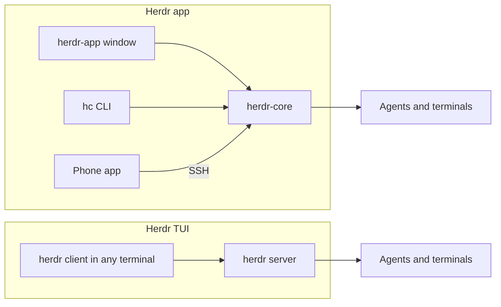

# Herdr setup for running many coding agents

[Herdr](https://herdr.dev/) runs coding agents in terminals that stay alive in a background server, and marks each agent as working, blocked, done or idle. It is free and open source under Apache 2.0. This guide covers choosing between its two products, installing them, agent status, restarts, macOS permissions, remote machines and the phone app. Facts were checked against herdr.dev and Herdr TUI 0.9.5 on 2026-11-17. Herdr changes quickly, so check its documentation before you rely on a detail.

## Herdr is two products that do not share agents

The herdr.dev FAQ says the two products "don't share agents, so what runs in one doesn't show up in the other". Pick one for daily work.

| | Herdr app | Herdr TUI |
|---|---|---|
| What it is | Native window (`herdr-app`) on top of the `herdr-core` runtime and its `hc` CLI | Terminal program (`herdr`) with its own server, run inside any terminal |
| Platforms | macOS (Apple silicon), Linux (x86_64, arm64), Windows (x86_64) | macOS, Linux, Windows |
| Agent status | Programs that report OSC 7501 | Screen reading plus optional per-harness integrations |
| After a reboot | Panes come back as shells in the same folder; agents are not restarted | Supported agents resume their conversation through integrations |
| Phone app | Supported | Not supported |
| Configuration | `~/.config/herdr-app/` (`settings.json`, `keys.json`, layouts, mods) | `~/.config/herdr/config.toml` |
| Documentation | [herdr.dev](https://herdr.dev/), and `~/.config/herdr-app/AGENTS.md` after install | [herdr.dev/tui/docs](https://herdr.dev/tui/docs/) |

Choose the app for a native window and phone access. Choose the TUI to resume agents after a reboot, or to keep working in the terminal you already use.



## Install

| Product | macOS and Linux | Windows |
|---|---|---|
| Herdr app (includes herdr-core) | `curl -fsSL https://releases.herdr.dev/app/install.sh \| sh`, or the [Herdr.dmg](https://releases.herdr.dev/app/Herdr.dmg) download on macOS | `powershell -c "irm https://releases.herdr.dev/app/install.ps1 \| iex"` |
| herdr-core on its own | `curl -fsSL https://releases.herdr.dev/core/install.sh \| sh` | `powershell -c "irm https://releases.herdr.dev/core/install.ps1 \| iex"` |
| Herdr TUI | `curl -fsSL https://herdr.dev/install.sh \| sh`, `brew install herdr` or `mise use -g herdr` | `powershell -ExecutionPolicy Bypass -c "irm https://herdr.dev/install.ps1 \| iex"` |

Sources: [herdr.dev](https://herdr.dev/), [herdr-core](https://herdr.dev/core/), [TUI install](https://herdr.dev/tui/docs/install/).

Updates:

- `hc update` updates herdr-core, and running terminals keep running.
- `herdr update` updates the TUI only when Herdr's own installer installed it. Update Homebrew, mise and Nix installs through those tools.

## First run

- **App:** start an agent from **+** in the tab bar. Ask the agent to read `~/.config/herdr-app/AGENTS.md`, the app's own manual, written for agents and matched to the installed version ([guide](https://herdr.dev/guide/)).
- **TUI:** run `herdr` to start or attach to the persistent session. `herdr --default-config` prints every setting with its default, and `herdr server reload-config` applies edits to `config.toml`.

## Agent status

### App: OSC 7501

The app does not read screens. A program reports its state with the OSC 7501 escape sequence (the Program Status Protocol). A program that does not send it still runs, without a status ([herdr-core](https://herdr.dev/core/)). If an agent shows no status, update the agent and run it directly in a Herdr pane, not inside tmux.

### TUI: integrations

The TUI recognizes several agents by screen. Integrations make status more accurate and record the session ID used for resume ([integrations](https://herdr.dev/tui/docs/integrations/)):

```bash
herdr integration install claude     # also: codex, opencode, kimi, grok, antigravity-cli, cursor, and others
herdr integration status
herdr integration uninstall claude
```

Each integration writes a hook script and a settings entry into the harness's own configuration, for example `~/.claude/hooks/herdr-agent-state.sh` and `~/.claude/settings.json`. `scripts/register_hooks.py` edits the same settings files, so review the diff after you run either one.

## What survives a restart

| Event | Herdr app | Herdr TUI |
|---|---|---|
| Close the window or client | Agents keep running | Agents keep running |
| Update the app | Agents keep running | Not applicable |
| Reboot, or the server stops | Programs stop. Panes return as shells in their last folder, and the original command never runs again | Programs stop. With `[session] resume_agents_on_restore = true` (the default) and integrations installed, supported agents reopen with their resume command |

Sources: herdr.dev FAQ and `herdr --default-config`.

## macOS permissions follow the launching app

macOS gives a privacy permission, such as Full Disk Access, to the app that started a process, not to the terminal pane.

- **App:** terminals run under Herdr Core (`dev.herdr.core`), which launchd starts. Grant permissions to Herdr Core in **System Settings** → **Privacy & Security**. Grants given to your terminal app do not apply.
- **TUI:** the server takes the permissions of the app that started it first, for example your terminal app. A server started from another app has that app's permissions.

An agent that scans the whole disk, for example with `find /`, causes many permission prompts at once. Limit agent searches to the project folder.

## Remote machines

Both products add machines over plain SSH. There is no Herdr account, and terminals do not pass through Herdr's servers ([herdr.dev](https://herdr.dev/)).

```bash
hc machine add user@my-server      # app and herdr-core
hc run --on my-server --bg claude
hc ls                              # this machine and my-server together

herdr machine add my-server        # TUI
```

Agents on a remote machine keep running while your laptop sleeps or the app is closed. For a machine outside your network, put both ends on Tailscale first. See the [Tailscale setup guide](guide-tailscale-setup.md).

## Phone app

The Herdr phone app runs on iPhone, iPad and Android. It shows which agents need you, opens the real terminal, and accepts typed, pasted or spoken replies ([mobile](https://herdr.dev/mobile)).

| Requirement | Detail |
|---|---|
| Herdr app on the computer | Herdr TUI isn't supported: agents started in the TUI do not appear. Spaces appear only while the app runs |
| SSH server on the computer | On macOS, turn on Remote Login |
| Network path | Same Wi-Fi, or Tailscale on both the phone and the computer when you are away |

To connect, open **Connect a machine** and fill in the form:

- **Address:** the computer's Tailscale name, or a local IP address.
- **User:** your user account on that computer.
- **Port:** `22`

Log in with the computer's password. For key login instead, tap **Copy phone's public key** and add that key to `~/.ssh/authorized_keys` on the computer. After the first machine connects, the app offers others from your SSH config and tailnet.

"Couldn't reach this machine" is a network failure, not a login failure: check that the phone's Tailscale is on. The [Tailscale guide's troubleshooting table](guide-tailscale-setup.md#troubleshooting) covers the other causes.

## Agents that start other agents

herdr-core lets one agent start, watch and message another, for example a reviewer in a different harness ([herdr-core](https://herdr.dev/core/)):

```bash
hc run --bg --name review codex "Review src/x.rs. When done: hc send $HC_TERMINAL_ID <result>"
hc wait review
hc read --lines 60 review
hc send review "also check the tests"
```

`hc --skill` prints the full manual in one read, which suits an agent that orchestrates others. Children appear as panes you can watch or answer.

## Telemetry

The app sends anonymous usage counts once a day by default: version, OS, which known agents ran, and counts of spaces, tabs and terminals. It never sends terminal content or file names, and herdr-core sends nothing. To turn it off, set `"telemetry": false` in `~/.config/herdr-app/settings.json`, or use **Settings** → **Privacy**. `DO_NOT_TRACK=1` or `HERDR_TELEMETRY=0` turns it off for one run. Source: `~/.config/herdr-app/AGENTS.md`.

## See also

- [Tailscale setup guide](guide-tailscale-setup.md)
- [Herdr source code](https://github.com/herdrdev): `herdr-app`, `herdr-core`, `herdr`
