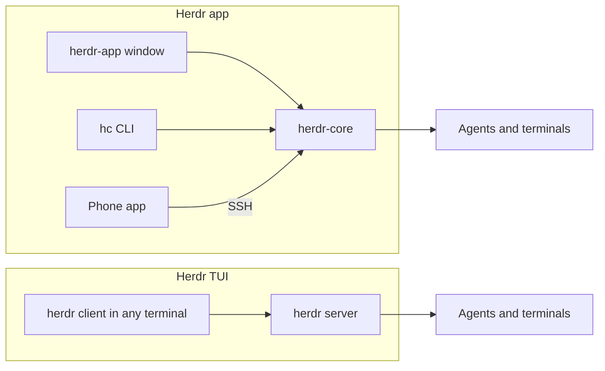
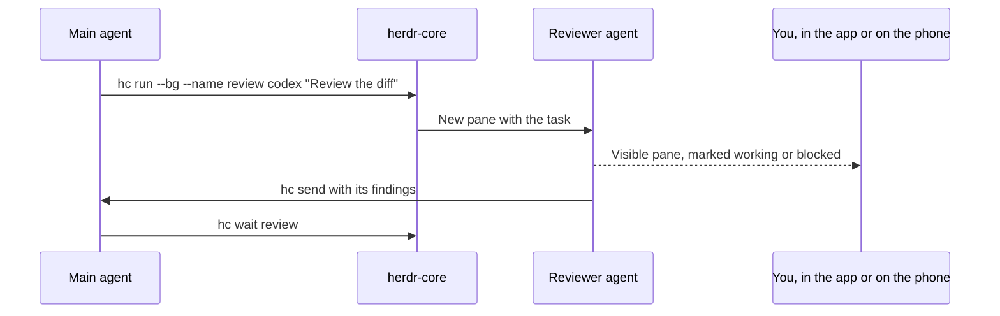

# Herdr for running many coding agents

This guide explains Herdr, a free, open-source workspace for running many coding agents in terminals that stay alive and report their status. It covers the problem it solves, its two products, common uses, setup, remote machines, the phone app, agents that start other agents, how it fits with this toolkit, and alternatives. It is for anyone running more than one or two agents at once, in any harness; facts were checked against herdr.dev and Herdr TUI 0.9.5 on 2026-11-17, and Herdr changes quickly, so confirm details in its documentation.

## Why a session runtime helps

Running one agent in one terminal tab is easy. Running five, in different repositories and different harnesses, causes three problems:

- **Finding the agent that needs you.** Tabs show no state, so a blocked agent waits until you happen to look.
- **Losing work when a window closes.** An agent in a terminal tab dies with the tab, the terminal app, or an SSH disconnect.
- **Work stops when the laptop stops.** Agents run only where the terminal runs.

A session runtime fixes these. It runs terminals in a background server, so closing the window does not stop them, and it shows which agent is working, blocked, done or idle. [Herdr](https://herdr.dev/) is a session runtime built for coding agents. It works with any agent that runs in a terminal: Claude Code, Codex, OpenCode, Antigravity, Kimi Code, Grok, Cursor and others. It is free and open source under Apache 2.0.

## Herdr is two products that do not share agents

The herdr.dev FAQ says the two products "don't share agents, so what runs in one doesn't show up in the other". Pick one for daily work.

| | Herdr app | Herdr TUI |
|---|---|---|
| What it is | Native window (`herdr-app`) on the `herdr-core` runtime and its `hc` CLI | Terminal program (`herdr`) with its own server, run inside any terminal |
| Platforms | macOS (Apple silicon), Linux (x86_64, arm64), Windows (x86_64) | macOS, Linux, Windows |
| Agent status | Programs that report OSC 7501 | Screen reading, plus optional per-harness integrations |
| After a reboot | Panes come back as shells in the same folder; agents are not restarted | Supported agents resume their conversation through integrations |
| Phone app | Supported | Not supported |
| Customization | JavaScript panels (mods), layouts, key bindings | Plugins and custom key commands |
| Configuration | `~/.config/herdr-app/` (`settings.json`, `keys.json`, layouts, mods) | `~/.config/herdr/config.toml` |
| Documentation | [herdr.dev](https://herdr.dev/), and `~/.config/herdr-app/AGENTS.md` after install | [herdr.dev/tui/docs](https://herdr.dev/tui/docs/) |

Choose the app for a native window, phone access, and agents that start other agents. Choose the TUI to resume agents after a reboot, or to stay in the terminal you already use.



## Common uses

| Use | How Herdr handles it | Section |
|---|---|---|
| Several agents in parallel, across repositories and harnesses | One window; each agent's state in the sidebar; a sound when one finishes or needs you | [Agent status](#agent-status) |
| Long tasks that must survive a closed window | Terminals live in the background server | [What survives a restart](#what-survives-a-restart) |
| Agents on a home server or cloud VM | Add the machine over SSH; its agents show beside local ones and keep running while the laptop sleeps | [Remote machines](#remote-machines) |
| Answering a blocked agent away from the desk | The phone app opens the real terminal | [Phone app](#phone-app) |
| A cross-model review: one agent asks another harness to review its work | `hc run` starts the reviewer as a visible pane and waits for its report | [Agents that start other agents](#agents-that-start-other-agents) |
| Dev servers and test runners beside the agents | `hc run --bg --name web bun dev`; agents can read their output with `hc read` | [Agents that start other agents](#agents-that-start-other-agents) |
| One agent per Git worktree | A New worktree dialog, or your own worktrees opened as spaces | [Worktrees](#worktrees) |

## Install

| Product | macOS and Linux | Windows |
|---|---|---|
| Herdr app (includes herdr-core) | `curl -fsSL https://releases.herdr.dev/app/install.sh \| sh`, or the [Herdr.dmg](https://releases.herdr.dev/app/Herdr.dmg) download on macOS | `powershell -c "irm https://releases.herdr.dev/app/install.ps1 \| iex"` |
| herdr-core only (servers, no window) | `curl -fsSL https://releases.herdr.dev/core/install.sh \| sh` | `powershell -c "irm https://releases.herdr.dev/core/install.ps1 \| iex"` |
| Herdr TUI | `curl -fsSL https://herdr.dev/install.sh \| sh`, `brew install herdr` or `mise use -g herdr` | `powershell -ExecutionPolicy Bypass -c "irm https://herdr.dev/install.ps1 \| iex"` |

Sources: [herdr.dev](https://herdr.dev/), [herdr-core](https://herdr.dev/core/), [TUI install](https://herdr.dev/tui/docs/install/).

To update:

- `hc update` updates herdr-core. Running terminals keep running.
- `herdr update` updates the TUI only when Herdr's own installer installed it. Update Homebrew, mise and Nix installs through those tools.

## First run

- **App:** start an agent from **+** in the tab bar. The app's manual is `~/.config/herdr-app/AGENTS.md`. It is written for agents and matches the installed version, so you can ask an agent to read it and change settings for you ([guide](https://herdr.dev/guide/)).
- **TUI:** run `herdr` to start or attach to the persistent session. `herdr --default-config` prints every setting with its default, and `herdr server reload-config` applies edits to `config.toml`.

Organize work as **spaces** (one per project or task), **tabs** inside a space, and **panes** inside a tab. Start each agent in its own pane, directly, not inside tmux, so Herdr can see its state.

## Agent status

Each agent shows one of four states: `working`, `blocked` (needs your answer), `done` (finished while you were not looking) or `idle`. A space or tab shows its most urgent agent.

### App: OSC 7501

The app does not read screens. A program reports its own state with the OSC 7501 escape sequence, the Program Status Protocol. A program that does not send it still runs, without a status ([herdr-core](https://herdr.dev/core/)). If an agent shows no status, update the agent and run it directly in a Herdr pane.

### TUI: integrations

The TUI recognizes several agents by their screen. Integrations make status more accurate and record the session ID that resume needs ([integrations](https://herdr.dev/tui/docs/integrations/)):

```bash
herdr integration install claude     # also codex, opencode, kimi, grok, antigravity-cli, cursor and others
herdr integration status
herdr integration uninstall claude
```

Each integration writes a hook script and a settings entry into the harness's own configuration, for example `~/.claude/hooks/herdr-agent-state.sh` and an entry in `~/.claude/settings.json`.

## What survives a restart

| Event | Herdr app | Herdr TUI |
|---|---|---|
| Close the window or client | Agents keep running | Agents keep running |
| Update the app | Agents keep running | Not applicable |
| Reboot, or the server stops | Programs stop. Panes return as shells in their last folder, and the original command never runs again | Programs stop. With `[session] resume_agents_on_restore = true` (the default) and integrations installed, supported agents reopen with their own resume command |

Sources: herdr.dev FAQ, and `herdr --default-config`. To keep agents running through a laptop reboot, run them on an always-on machine (see [Remote machines](#remote-machines)).

## macOS permissions follow the launching app

macOS gives a privacy permission, such as Full Disk Access, to the app that started a process, not to the terminal pane.

- **App:** terminals run under Herdr Core (`dev.herdr.core`), which launchd starts. Grant permissions to Herdr Core in **System Settings** → **Privacy & Security**. Grants given to your terminal app do not apply.
- **TUI:** the server takes the permissions of the app that started it first, usually your terminal app.

An agent that searches the whole disk, for example with `find /`, triggers many permission prompts at once. Keep agent searches inside the project folder.

## Worktrees

A Git worktree is a second checkout of the same repository on another branch, so parallel agents do not edit the same files.

- **App:** the New worktree dialog creates `<directory>/<repo>/<branch>`, with branch slashes turned into dashes. The default directory is `~/.herdr/worktrees`; change it with `"worktrees": { "directory": "~/path" }` in `~/.config/herdr-app/settings.json`. The app does not read the TUI's `[worktrees]` setting.
- **TUI:** set `[worktrees] directory` in `config.toml`.

This toolkit keeps worktrees inside each repository at `.worktrees/<harness>/<branch>`, as the [`git-worktrees` skill](../skills/git-worktrees/) describes. Herdr's directory setting cannot produce that layout. To follow the toolkit convention, let your agent create the worktree through the skill, then open its folder in a Herdr space.

## Remote machines

Both products add machines over plain SSH. There is no Herdr account, and terminals do not pass through Herdr's servers ([herdr.dev](https://herdr.dev/)).

```bash
hc machine add user@my-server      # app and herdr-core: installs and starts herdr-core there
hc run --on my-server --bg claude  # start an agent on it
hc ls                              # this machine and my-server together

herdr machine add my-server        # TUI
```

Agents on a remote machine keep running while your laptop sleeps or the app is closed. For a machine outside your local network, put both ends on Tailscale first; see the [Tailscale guide](guide-tailscale-setup.md).

## Phone app

The Herdr phone app runs on iPhone, iPad and Android. It shows which agents need you, opens the real terminal, and accepts typed, pasted or spoken replies ([mobile](https://herdr.dev/mobile)).

| Requirement | Detail |
|---|---|
| Herdr app on the computer | Herdr TUI isn't supported, so agents started in the TUI do not appear. Spaces appear only while the app runs |
| SSH server on the computer | On macOS, turn on Remote Login ([steps](guide-tailscale-setup.md#turn-on-remote-login-on-macos)) |
| Network path | Same Wi-Fi, or Tailscale on both the phone and the computer when you are away |
| Computer awake | A sleeping computer drops the connection ([fixes](guide-tailscale-setup.md#keep-the-host-reachable)) |

To connect, open **Connect a machine** and fill in the form:

- **Address:** the computer's Tailscale name, or a local IP address.
- **User:** your user account on that computer.
- **Port:** `22`

Log in with the computer's password. For key login instead, tap **Copy phone's public key** and add the key to `~/.ssh/authorized_keys` on the computer. After the first machine connects, the app offers others from your SSH config and tailnet.

"Couldn't reach this machine" is a network failure, not a login failure: check that the phone's Tailscale is on.

## Agents that start other agents

herdr-core lets one agent start, watch and message another, in the same or a different harness ([herdr-core](https://herdr.dev/core/)). A Claude Code session can, for example, ask Codex to review its change:



```bash
hc run --bg --name review codex "Review the diff. When done: hc send $HC_TERMINAL_ID <result>"
hc wait review                    # waits until it stops working; never poll
hc read --lines 60 review         # read its screen
hc send review "also check the tests"
hc wait --children any            # several helpers: the next one with news
```

- **Templates** give reusable roles. Each is a Markdown file in `~/.config/herdr-core/templates/<name>.md`, with `name`, `description` and the harness command in its frontmatter and the role's instructions in its body. `hc templates` lists them.
- **Lifetime:** helpers end with the agent that started them, unless started with `--outlive-parent`.
- **Other machines:** add `--on my-server` to run the helper there.
- **Manual:** `hc --skill` prints the full rules in one read, written for agents.

Use harness-native subagents for quick lookups inside one session. Use `hc` helpers when you want a different model or harness, or want to watch, answer or keep the helper.

## How Herdr fits with this toolkit

The toolkit does not require Herdr. Every skill and hook works in a plain terminal. Herdr adds the session layer on top:

| Toolkit piece | Relation to Herdr |
|---|---|
| [`scripts/sync-toolkit.sh`](../scripts/) and `scripts/register_hooks.py` | Register the toolkit's hooks in harness settings. Herdr TUI integrations edit the same settings files, so review the diff after you run either |
| [`resume-session`](../skills/resume-session/) | Continues an interrupted session from its transcript, in any harness. Use it when Herdr cannot resume an agent, for example after a reboot with the app |
| [`schedule-resume`](../skills/schedule-resume/) | Continues a session later, for example after a usage limit resets. On an always-on machine, it keeps work moving overnight |
| [`git-worktrees`](../skills/git-worktrees/) | Sets the worktree location for every harness; see [Worktrees](#worktrees) |
| [Tailscale guide](guide-tailscale-setup.md) | Connects the phone and remote machines that Herdr uses |

## Alternatives

| Tool | What it is | Choose it when |
|---|---|---|
| [tmux](https://github.com/tmux/tmux) | Classic terminal multiplexer with a background server | You want a proven, SSH-friendly tool and can live without agent status. Add [workmux](https://github.com/raine/workmux) for worktrees and agent states |
| [Zellij](https://zellij.dev/) | Terminal multiplexer with layouts, key hints and a web client (MIT) | You want an easier tmux, without agent status |
| [cmux](https://github.com/manaflow-ai/cmux) | Native macOS terminal built on Ghostty, with agent notifications and resume hooks | You work only on macOS, want a polished app, and use Ghostty's configuration |
| [Orca](https://github.com/stablyai/orca) | Orchestrator that gives each task its own worktree and agent, with desktop and phone apps (MIT) | You ship many small, independent tasks and like a chat-first view |
| [Zed](https://zed.dev/docs/ai/external-agents) | Editor with an agent panel and parallel agent threads | You live in an editor; agents run as editor child processes and stop with it |
| Claude Code Remote Control | Controls a local Claude Code session from the phone | You use only Claude Code |
| Cloud agents, such as Claude Code on the web or Codex cloud | The vendor runs the agent in its own sandbox | You want work to run with no machine of your own; each covers one vendor |

## Troubleshooting

| Symptom | Cause | Fix |
|---|---|---|
| An agent shows no status | Old agent version, the agent runs inside tmux, or no OSC 7501 support | Update the agent, run it directly in a pane; on the TUI, install its integration |
| Agents from the TUI do not appear in the app or on the phone | The two products do not share agents | Start the agent in the app |
| Agents are gone after a reboot (app) | The app does not restart agents | Resume with the harness's own resume command, or with `resume-session` |
| Permission prompts name Herdr Core | Herdr Core started the process | Grant the permission to Herdr Core, or keep agent searches inside the project |
| The phone says "Couldn't reach this machine" | No network path | Turn on Tailscale on the phone; see the [Tailscale troubleshooting table](guide-tailscale-setup.md#troubleshooting) |

## Telemetry

The app sends anonymous usage counts once a day by default: version, OS, which known agents ran, and counts of spaces, tabs and terminals. It never sends terminal content or file names, and herdr-core sends nothing. To turn it off, set `"telemetry": false` in `~/.config/herdr-app/settings.json`, or use **Settings** → **Privacy**. `DO_NOT_TRACK=1` or `HERDR_TELEMETRY=0` turns it off for one run. Source: `~/.config/herdr-app/AGENTS.md`, version current on 2026-11-17.

## See also

- [Tailscale guide](guide-tailscale-setup.md): reach your agents' machines from a phone or laptop
- [Harness plugin parity guide](guide-harness-plugin-parity.md): the same skills, hooks and MCP servers in every harness
- [Herdr source code](https://github.com/herdrdev): `herdr-app`, `herdr-core`, `herdr`
