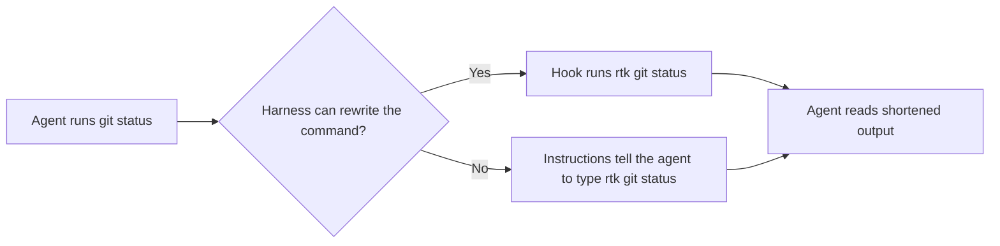

# RTK setup across harnesses

[RTK](https://github.com/rtk-ai/rtk) is a command-line proxy that shortens the output of common shell commands, such as `git status`, test runners and linters, before an AI agent reads it. Upstream describes it as cutting "up to 90% of the bash output your agent reads", and notes that this is not the same as cutting your bill by 90% (checked 2026-09-22).

This guide shows how to connect RTK to each supported harness.

## Two ways to connect it

| Mode | How it works | Harnesses |
|---|---|---|
| Automatic rewrite | A hook or plugin rewrites each shell command, for example `git status` to `rtk git status`, before it runs. The agent needs no instructions. | Claude Code, Cursor, Codex, Antigravity, OpenCode |
| Instruction prefix | The agent's instructions tell it to put `rtk` in front of shell commands itself | Kimi Code, Grok Build TUI, Muse Code |



Automatic rewriting covers shell commands only. Claude Code's built-in `Read`, `Grep` and `Glob` tools do not go through the shell, so their output is not shortened.

## Install RTK

Use one of the upstream install methods:

```bash
brew install rtk
```

```bash
curl -fsSL https://raw.githubusercontent.com/rtk-ai/rtk/refs/heads/master/install.sh | sh
```

```bash
cargo install --git https://github.com/rtk-ai/rtk
```

Check the install with `rtk gain`. A different crate named `rtk` exists on crates.io. If `rtk gain` fails, you probably installed that one, so use the `cargo install --git` command above.

## Connect each harness

### Claude Code

Run `rtk init -g`, or add the hook to `~/.claude/settings.json` yourself:

```json
"hooks": {
  "PreToolUse": [
    {
      "matcher": "Bash",
      "hooks": [
        {
          "type": "command",
          "command": "rtk hook claude"
        }
      ]
    }
  ]
}
```

### Cursor

Run `rtk init -g --agent cursor`, or add the hook to `~/.cursor/hooks.json`:

```json
"beforeShellExecution": [
  {
    "command": "rtk hook cursor"
  }
]
```

### OpenCode

Run `rtk init -g --opencode --hook-only` to install RTK's plugin, which rewrites commands before they run. `--hook-only` skips the `RTK.md` file and the `CLAUDE.md` reference, so a shared instruction file is not edited. The plugin passes each command to `rtk hook opencode`, so RTK upgrades reach it without a reinstall. It rewrote `git log` on OpenCode 2.1.4 with RTK 1.1.0 (checked 2026-11-02). `scripts/sync-toolkit.sh --harness` reports when the plugin is missing and does not write it.

### Codex

RTK 0.50.0 and later rewrite Codex commands with `rtk hook codex`, a `PreToolUse` hook on the `Bash` matcher. Here, unlike the other harnesses, `scripts/sync-toolkit.sh --harness` adds it to `~/.codex/hooks.json` by the full path of `rtk`, because a bare `rtk` can fail with exit 127 in Codex started from a desktop app ([rtk-ai/rtk#4560](https://github.com/rtk-ai/rtk/issues/4560)). Trust it once in `/hooks`; Codex skips an untrusted hook.

Do not run `rtk init -g --codex` when `~/.codex/AGENTS.md` is a link to the shared instruction file: it writes through the link into that file ([rtk-ai/rtk#4156](https://github.com/rtk-ai/rtk/issues/4156)). The hook passes a command through unchanged when Codex reports a permission mode RTK does not know; Codex 0.166.0 sends `bypassPermissions` under `--yolo`, which RTK accepts.

### Antigravity

Run `rtk init -g --agent antigravity` (RTK 0.51.0 or later). It installs a plugin at `~/.gemini/config/plugins/rtk/` whose `PreToolUse` hook calls `rtk hook antigravity`, and writes RTK's agent text inside the plugin, so no shared instruction file is edited. It rewrote `git log` in Antigravity CLI 1.4.12 with RTK 1.1.0 (checked 2026-11-02). `scripts/sync-toolkit.sh --harness` reports when the plugin is missing and does not write it. The [rule file](../rules/antigravity-rtk-rules.md) that tells the agent to prefix commands stays available for an Antigravity without the plugin.

### Kimi Code

Kimi Code's hooks can allow or deny a tool call but cannot change it, so automatic rewriting is not possible. Run `rtk init --agent kimi` (RTK 0.44.0 or later) to add project instructions that tell the agent to prefix commands. The RTK section of the shared instruction file, which Kimi reads from `~/.agents/AGENTS.md`, says the same.

### Grok Build TUI

Grok's own `PreToolUse` hooks could rewrite commands, but Grok does not load Claude hooks, and RTK's Claude hook cannot read Grok's camelCase payload. There is no `rtk init` option for Grok, so do not run another agent's option in its place. Grok reads the shared instruction file through its Claude compatibility setting, and that file tells it to prefix commands with `rtk`.

### Muse Code

Muse's `PreToolUse` plugin hooks accept the output of `rtk hook claude`, but Muse 1.4.14 applies a rewrite only when it carries `permissionDecision: "allow"`. RTK sets that only for commands your Claude Code permission rules allow, so a hook would leave most commands unfiltered. Muse reads the shared instruction file, which tells it to prefix commands with `rtk`, and no hook is installed.

## Keep it current

The hooks and plugins only call the `rtk` binary, so `brew upgrade rtk` brings new filters and rewrite fixes without a reinstall. RTK also ships the agent text that the shared instruction file's RTK section follows. `scripts/sync-toolkit.sh --harness` generates that text from the installed `rtk` in a throwaway home and compares it with `scripts/rtk-awareness.snapshot.md`. When it differs, sync reports it: update the RTK section of `instructions/CLAUDE.md`, then the snapshot.

## Check that it works

```bash
which rtk
rtk --version
rtk gain              # savings so far
rtk gain --history    # savings over time
rtk hook check "git status"   # shows how RTK would rewrite a command
```

After a session in any harness, `rtk gain` should show new activity.

## See also

- [RTK repository](https://github.com/rtk-ai/rtk)
- [Harness plugin parity guide](guide-harness-plugin-parity.md)
