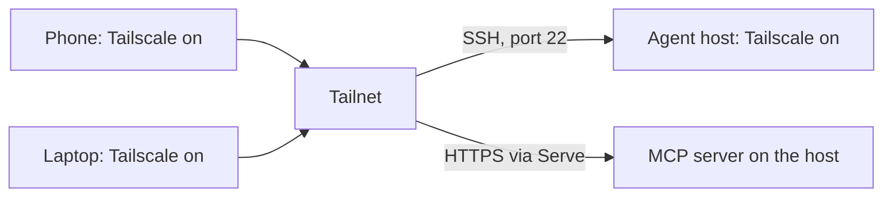
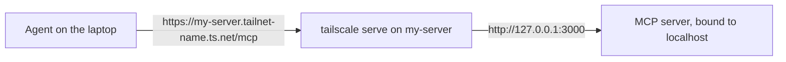

# Tailscale for agent workstations

This guide explains Tailscale and how to use it to reach the computers and services your coding agents run on. It covers what Tailscale is, its common uses in agent work (SSH from a phone, sharing a local MCP server, previewing a dev server), step-by-step setup, keeping a host reachable, and alternatives. It is for anyone who runs agents on one machine and wants to check on them or use their tools from another; facts were checked against Tailscale's documentation on 2026-11-17.

## Why a private network helps agent work

Agents run on one computer, called the agent host in this guide: a laptop, a home server or a cloud VM. You often want to reach that computer from somewhere else: answer a blocked agent from your phone, start a job on a stronger machine, or let an agent on your laptop call an MCP server running on your home server. Opening ports to the internet for this is risky, and a home network usually blocks incoming connections anyway.

[Tailscale](https://tailscale.com/) solves this by putting your devices on one private network, called a **tailnet**. Devices connect to each other directly over encrypted WireGuard tunnels, from any network, including mobile data, with no port forwarding. Only devices signed in to your tailnet can reach each other.

The free Personal plan allows up to 6 users and unlimited user devices ([pricing](https://tailscale.com/pricing), checked 2026-11-17).

## Terms used in this guide

| Term | Meaning |
|---|---|
| Tailnet | Your private network: every device signed in with your account |
| Machine or node | One device on the tailnet |
| MagicDNS | Automatic names for tailnet devices, such as `my-mac` |
| Tailscale SSH | Tailscale handles SSH login with your Tailscale identity instead of passwords or keys |
| Serve | Shares a local web service with your tailnet only, over HTTPS |
| Funnel | Shares a local web service with the whole internet |
| Exit node | A tailnet device that carries all your internet traffic, like a VPN server |
| Policy file | The tailnet's access rules (who can reach what), edited in the admin console |

## Common uses in agent work

| Use | How | Section |
|---|---|---|
| SSH into the agent host from a laptop or phone | Normal SSH or Tailscale SSH over the tailnet | [Set up SSH](#set-up-ssh-to-the-agent-host) |
| Answer agents from a phone | The [Herdr](guide-herdr-setup.md) phone app over SSH | [Herdr guide](guide-herdr-setup.md#phone-app) |
| Run agents on an always-on machine and reach them from anywhere | Home server or cloud VM on the tailnet, with a session runtime such as Herdr or tmux | [Herdr guide](guide-herdr-setup.md#remote-machines) |
| Use one MCP server from all your machines | Run it once, share it with `tailscale serve` | [Share a local MCP server](#share-a-local-mcp-server-with-your-tailnet) |
| Preview a dev server on your phone | `tailscale serve 3000`, then open the HTTPS address on the phone | [Share a local MCP server](#share-a-local-mcp-server-with-your-tailnet) (same steps) |
| Let a web assistant or webhook reach a local service | `tailscale funnel`, with care | [Expose a service publicly](#expose-a-service-publicly-with-funnel) |
| Copy files between devices | `tailscale file cp <file> <device>:` (Taildrop) | `tailscale file --help` |

## Every device needs Tailscale

A device reaches a tailnet address only while its own Tailscale is connected. A phone without Tailscale gets "couldn't reach" errors even when the host is online.



## Choose the macOS variant

Tailscale ships three macOS variants with different abilities ([macOS variants](https://tailscale.com/kb/1065/macos-variants)):

| Variant | GUI | Tailscale SSH server | Funnel | Notes |
|---|---|---|---|---|
| Standalone | Yes | No | No | Tailscale's recommendation. No Apple ID; faster security updates |
| Mac App Store | Yes | No | No | Use only when Standalone cannot be installed |
| Open-source `tailscaled` | No | Yes | Yes | For unattended installs managed by experienced administrators |

Do not install the Mac App Store and Standalone variants on the same machine. A Mac host that must be a Tailscale SSH server, or run Funnel, needs `tailscaled`. Otherwise use Standalone and normal SSH. Linux and Windows have one client each ([downloads](https://tailscale.com/download)).

## Install and sign in

1. **Agent host (macOS):** download the Standalone package from [pkgs.tailscale.com](https://pkgs.tailscale.com/stable/#macos), run it, follow the onboarding to install the VPN configuration, and sign in with your identity provider ([install on macOS](https://tailscale.com/kb/1016/install-mac)). macOS 13 or later is required.
2. **Agent host (Linux):** follow [Tailscale's Linux install](https://tailscale.com/download/linux), then run `sudo tailscale up`.
3. **Phone (Android):** install Tailscale from Google Play, tap **Get Started**, accept the VPN configuration prompt, and sign in ([install on Android](https://tailscale.com/kb/1079/install-android)). On iPhone, install it from the App Store.
4. **Sign in with the same account everywhere.** Use the same identity provider and account on every device. Then open the device list on each new device and check that the host appears.

On the host, `tailscale status` lists every device on the tailnet. A new device appears once it has joined.

## Use machine names, not IP addresses

MagicDNS is on by default for tailnets created on or after 2022-10-20 ([MagicDNS](https://tailscale.com/kb/1081/magicdns)).

| Form | Example | When it works |
|---|---|---|
| Short name | `my-mac` | Your own devices, with MagicDNS on |
| Full name | `my-mac.tailnet-name.ts.net` | Always, including devices shared with you; required for HTTPS |
| Tailscale IP | `100.x.y.z` | Always; skips name lookup |

Renaming a machine changes its MagicDNS name automatically, so update saved addresses on your other devices. `tailscale status --json` shows the full name in `Self.DNSName`.

## Set up SSH to the agent host

Tailscale carries the traffic, and an SSH server on the host checks the login. There are two ways to set that up:

| Method | Host platforms | Login | Setup |
|---|---|---|---|
| Normal SSH over the tailnet | Any host with an SSH server, including macOS with the Standalone or App Store app | Password, or SSH key in `~/.ssh/authorized_keys` | Turn on the host's SSH server |
| Tailscale SSH | Linux, and macOS with `tailscaled` only | Tailscale identity; no keys to manage | `tailscale set --ssh` on the host, plus policy rules |

Tailscale SSH needs policy rules that allow both network access and SSH access. The default policy lets you SSH into your own devices in check mode, where you sign in with your identity provider again before connecting ([Tailscale SSH](https://tailscale.com/kb/1193/tailscale-ssh)). Some client apps say Tailscale SSH "works without setting up a key". That is true only when the host runs Tailscale SSH: a Mac with the GUI app uses normal SSH.

### Turn on Remote Login on macOS

1. Open **System Settings** → **General** → **Sharing**.
2. Click the **Info** button next to **Remote Login** and turn it on.
3. Under **Allow access for**, choose **All users**, or **Only these users** and add your account ([Apple Support](https://support.apple.com/guide/mac-help/allow-a-remote-computer-to-access-your-mac-mchlp1066/mac)).

An access list set to **Only these users** with nobody in it can reject a correct password. For key login, add the client's public key to `~/.ssh/authorized_keys` on the host.

Test from another tailnet device:

```bash
ssh your-user@my-mac
```

## Share a local MCP server with your tailnet

An MCP server gives agents tools, such as a memory store or a database client. If it speaks the HTTP transport, you can run it once on one machine and use it from every agent on every machine. Tailscale Serve puts it behind an HTTPS address that only your tailnet can reach ([Serve](https://tailscale.com/kb/1312/serve)).



1. **Start the MCP server on the host, bound to localhost only**, for example on port 3000. Binding to `127.0.0.1` means nothing reaches it except through Serve. A server that only supports the stdio transport needs an HTTP bridge first; check the server's documentation.
2. **Share it with the tailnet:**

   ```bash
   tailscale serve --bg 3000      # keeps running in the background
   tailscale serve status         # shows the HTTPS address
   tailscale serve reset          # stops sharing
   ```

   The first run asks you to enable HTTPS certificates for the tailnet, if they are not on yet.
3. **Add it to a harness on another device**, for example Claude Code ([Claude Code MCP](https://code.claude.com/docs/en/mcp)):

   ```bash
   claude mcp add --transport http memory https://my-server.tailnet-name.ts.net/mcp
   ```

   Other harnesses take the same URL in their MCP configuration. The [harness plugin parity guide](guide-harness-plugin-parity.md) shows where each one keeps it.

What Serve gives you:

- **Tailnet-only access.** Devices outside your tailnet cannot connect, and the tailnet's access rules apply.
- **Identity headers.** Serve adds `Tailscale-User-Login` and `Tailscale-User-Name` to each request from a user's device, and strips incoming copies so they cannot be forged. A server can use them to know who is calling. Tagged devices send no identity headers.
- **No certificates to manage.** HTTPS uses a certificate for the device's full MagicDNS name.

Add a bearer token in the server anyway if other people share your tailnet: Serve keeps strangers out, but every tailnet member can still reach the URL. The same steps work for a dev server: `tailscale serve --bg 5173`, then open the address on your phone.

## Expose a service publicly with Funnel

Web-based assistants and webhooks call your service from their own cloud, so a tailnet-only address does not work for them. Funnel gives a local service a public HTTPS address under your tailnet's `ts.net` name ([Funnel](https://tailscale.com/kb/1223/funnel)).

```bash
tailscale funnel 3000      # prints a public https:// address
```

| Requirement or limit | Detail |
|---|---|
| Ports | 443, 8443 and 10000 only |
| Tailnet settings | MagicDNS and HTTPS on; a `funnel` node attribute in the policy file |
| macOS | The open-source `tailscaled` variant only |
| Same port | A port cannot be shared by Serve and Funnel at once; the latest command wins |
| New address | Public DNS can take up to 10 minutes to work |

Funnel makes the service reachable by anyone who knows the address, and it adds no identity headers. Put authentication in the service itself, such as OAuth or a token, before you expose it. Never funnel a shell, an SSH server, or an MCP server that can run commands or edit files.

## Keep the host reachable

Tailscale does not keep a computer awake, and a sleeping host drops every remote session.

| Issue | Fix |
|---|---|
| macOS sleeps when idle | `sudo pmset -c sleep 0` stops idle sleep on AC power only. `pmset -g custom` shows the current values |
| A laptop sleeps when its lid closes | `pmset` sleep settings do not stop lid sleep. Keep the lid open, or use an always-on host |
| `caffeinate` started in a terminal | Stops when that terminal closes or the computer restarts, so it is not a lasting fix |
| Device keys expire | By default a device must sign in again every 180 days, and its connections stop when its key expires. For an always-on host, open the Machines page in the admin console and choose **Disable Key Expiry** ([key expiry](https://tailscale.com/kb/1028/key-expiry)) |

## Alternatives

| Tool | What it is | Choose it when |
|---|---|---|
| [Headscale](https://github.com/juanfont/headscale) | Open-source, self-hosted replacement for Tailscale's coordination server (BSD-3-Clause), for a single tailnet; uses the normal Tailscale apps | You want no third-party control server and can run one yourself |
| [NetBird](https://github.com/netbirdio/netbird) | WireGuard-based private network, self-hostable or hosted | You want a Tailscale-like network with a fully open-source server |
| [ZeroTier](https://www.zerotier.com/) | Virtual network across devices | You already use it, or need layer 2 networking |
| Plain [WireGuard](https://www.wireguard.com/) | The VPN protocol Tailscale builds on, configured by hand | You have few devices, a reachable server, and want no extra service |
| [Cloudflare Tunnel](https://developers.cloudflare.com/cloudflare-one/networks/connectors/cloudflare-tunnel/) | Outbound-only connector (`cloudflared`) that publishes a service through Cloudflare | You need a public service on your own domain, in place of Funnel |
| [ngrok](https://ngrok.com/) | Hosted tunnel that gives a local port a public URL | You need a quick, temporary public URL for a demo or webhook |
| Plain SSH with port forwarding | `ssh -L` from a client that can already reach the host | The host already has a reachable SSH port, and you need one service briefly |

## Troubleshooting

| Symptom | Cause | Fix |
|---|---|---|
| "Couldn't reach" or a timeout from the phone | The phone is not on the tailnet, or its VPN is off | Turn Tailscale on in the phone; check that `tailscale status` on the host lists the phone |
| The phone's device list does not show the host | The phone signed in with another provider or account | Sign out and sign in with the same provider and account as the host |
| The name does not resolve | MagicDNS is off, or the name changed | Use the full name or the Tailscale IP |
| `Permission denied` with a correct password | The Remote Login access list excludes your user | Set **Allow access for** to include your account |
| `tailscale serve` prompts for consent | HTTPS certificates are not enabled for the tailnet | Approve the prompt; it opens the admin console |
| An HTTPS address fails with the short name | Certificates cover only the full name | Use `my-host.tailnet-name.ts.net` |
| Sessions drop after some minutes idle | The host went to sleep | See [Keep the host reachable](#keep-the-host-reachable) |

## See also

- [Herdr setup guide](guide-herdr-setup.md): run agents in terminals that stay alive, and answer them from a phone over Tailscale
- [Harness plugin parity guide](guide-harness-plugin-parity.md): where each harness keeps its MCP servers
- [Tailscale knowledge base](https://tailscale.com/kb) and [Serve and Funnel use cases](https://tailscale.com/kb/1247/funnel-serve-use-cases)
