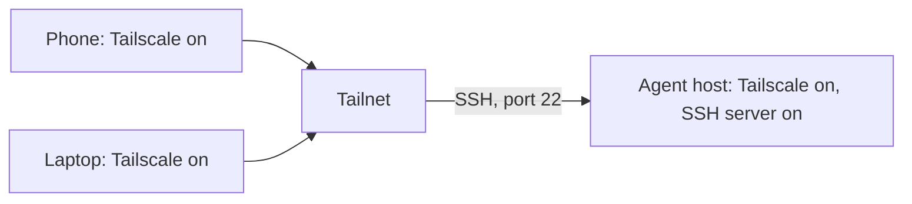

# Tailscale setup for reaching agents remotely

[Tailscale](https://tailscale.com/) puts your devices on one private network, called a tailnet, that works from any connection, including mobile data. This guide sets it up so a phone or laptop can reach the computer that runs your coding agents over SSH, for example with the [Herdr](guide-herdr-setup.md) phone app. Facts were checked against Tailscale's documentation on 2026-11-17.

## Every device needs Tailscale

A device can reach a tailnet address only while its own Tailscale is connected. A phone without Tailscale gets "couldn't reach" errors, even when the computer is online.

| Device | Needs |
|---|---|
| Agent host (the computer that runs the agents) | Tailscale, an SSH server, and no sleep while you need it |
| Phone or laptop | Tailscale, signed in to the same tailnet |

## Choose the macOS variant

Tailscale ships three macOS variants ([macOS variants](https://tailscale.com/kb/1065/macos-variants)):

| Variant | GUI | Tailscale SSH server | Notes |
|---|---|---|---|
| Standalone | Yes | No | Tailscale's recommendation. No Apple ID; faster security updates |
| Mac App Store | Yes | No | Use only when Standalone cannot be installed |
| Open-source `tailscaled` | No | Yes | For unattended installs managed by experienced administrators |

Do not install the Mac App Store and Standalone variants on the same machine. Linux and Windows have one client each; see [Tailscale's download page](https://tailscale.com/download).

## Install and sign in

1. **Agent host (macOS):** download the Standalone package from [pkgs.tailscale.com](https://pkgs.tailscale.com/stable/#macos), run it, follow the onboarding to install the VPN configuration, and sign in with your identity provider ([install on macOS](https://tailscale.com/kb/1016/install-mac)). It needs macOS 13 or later.
2. **Phone (Android):** install Tailscale from Google Play, tap **Get Started**, accept the VPN configuration prompt, and sign in ([install on Android](https://tailscale.com/kb/1079/install-android)). On iPhone, install it from the App Store.
3. **Use the same account on every device.** Sign in with the same identity provider and account as the agent host. Then open the device list in the phone's Tailscale app and check that the agent host appears there.

From a terminal on the host, `tailscale status` lists every device on the tailnet. The phone appears there once it has joined.

## Use the machine name, not the IP

MagicDNS gives each device a name. It is on by default for tailnets created on or after 2022-10-20 ([MagicDNS](https://tailscale.com/kb/1081/magicdns)).

| Form | Example | When it works |
|---|---|---|
| Short name | `my-mac` | Your own devices, with MagicDNS on |
| Full name | `my-mac.tailnet-name.ts.net` | Always, including devices shared with you |
| Tailscale IP | `100.x.y.z` | Always; it skips name lookup |

Renaming a machine in the admin console or the Tailscale app changes its MagicDNS name automatically. Update saved addresses on your other devices after a rename. `tailscale status --json` shows the full name in `Self.DNSName`.

## Pick an SSH login method

Tailscale carries the traffic, but an SSH server on the host still accepts the login. There are two ways to provide it:

| Method | Host platforms | Login | Setup |
|---|---|---|---|
| Normal SSH over the tailnet | Any host with an SSH server, including macOS with the Standalone or App Store app | Password or SSH key in `~/.ssh/authorized_keys` | Turn on the host's SSH server |
| Tailscale SSH | Linux, and macOS with open-source `tailscaled` only | Tailscale identity; no keys to manage | `tailscale set --ssh` on the host, plus tailnet policy rules |

Tailscale SSH needs policy rules that allow both network access and SSH access. The default policy lets you SSH into your own devices in check mode (you sign in with your identity provider again before connecting), and only Tailscale SSH connections use it ([Tailscale SSH](https://tailscale.com/kb/1193/tailscale-ssh)). A client app that says Tailscale SSH "works without setting up a key" is right only when the host runs Tailscale SSH. A Mac with the GUI app uses normal SSH.

### Turn on Remote Login on macOS

1. Open **System Settings** → **General** → **Sharing**.
2. Click the **Info** button next to **Remote Login** and turn it on.
3. Under **Allow access for**, choose **All users**, or **Only these users** and add your account ([Apple Support](https://support.apple.com/guide/mac-help/allow-a-remote-computer-to-access-your-mac-mchlp1066/mac)).

An access list that is set to **Only these users** but has nobody in it can reject a correct password. For key login, add the client's public key to `~/.ssh/authorized_keys` on the host. Apps such as Herdr's phone app have a button that copies their public key.

## Keep the host reachable

Tailscale does not keep a computer awake. A sleeping host drops every remote session.

| Issue | Fix |
|---|---|
| macOS sleeps when idle | `sudo pmset -c sleep 0` stops idle sleep on AC power only; `pmset -g custom` shows the current values |
| A laptop sleeps when its lid closes | `pmset` sleep settings do not stop lid sleep. Keep the lid open, or use an always-on host |
| `caffeinate` started in a terminal | Stops when that terminal closes or the computer restarts, so it is not a lasting fix |
| Device keys expire | By default a device must sign in again every 180 days, and its connections stop when its key expires. For an always-on host, open the Machines page in the admin console and choose **Disable Key Expiry** ([key expiry](https://tailscale.com/kb/1028/key-expiry)) |

## Troubleshooting

| Symptom | Cause | Fix |
|---|---|---|
| "Couldn't reach" or a timeout from the phone | The phone is not on the tailnet, or its VPN is off | Turn Tailscale on in the phone; check that `tailscale status` on the host lists the phone |
| The phone's device list does not show the host | The phone signed in with another provider or account | Sign out and sign in with the same provider and account as the host |
| The name does not resolve | MagicDNS is off, or the name changed | Use the full name or the Tailscale IP |
| `Permission denied` with a correct password | The Remote Login access list excludes your user | Set **Allow access for** to include your account |
| Sessions drop after some minutes idle | The host went to sleep | See the table in the previous section |

## See also

- [Herdr setup guide](guide-herdr-setup.md)
- [Tailscale knowledge base](https://tailscale.com/kb)
