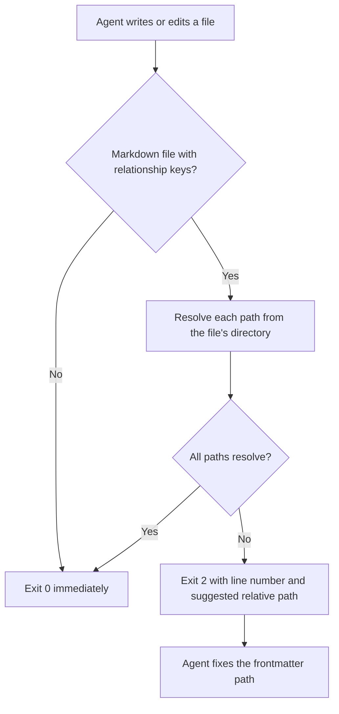

# validate-frontmatter

A hook that checks YAML frontmatter relationship paths (`related`, `supersedes`, `superseded_by`) as an agent writes them. When a Markdown file has a frontmatter block at byte 0, the hook verifies that every local path in those fields resolves relative to the file's own directory—the same rule Markdown body links use. If a path fails to resolve, the hook sends the error (and a suggested relative replacement when the target exists at the working-memory or repository root) back to the agent so it fixes the link in the same turn.

## Why it exists

Agents often write `related:` entries relative to the working-memory root (for example `0-brainstorms/topic.md`) or the repository root (for example `guides/guide-foo.md`) while writing body links relative to the file (`../0-brainstorms/topic.md`). Editors and IDEs such as VS Code (with Penmark), Cursor and Antigravity IDE resolve frontmatter paths from the file's directory, so root-relative entries fail to open on click. File-relative paths work identically whether lifecycle docs live under `docs/` or in a separate nested working-memory repository.

## What it catches

- A bare working-memory-root path such as `0-brainstorms/2026-10-30-topic.md` inside `1-research/study.md` (suggests `../0-brainstorms/2026-10-30-topic.md`)
- A bare repository-root path such as `guides/guide-rtk-setup.md` inside a lifecycle or `reference/` document (suggests `../../guides/guide-rtk-setup.md` or `../guides/guide-rtk-setup.md`)
- An absolute filesystem path (`/path/to/...`) in `related`, `supersedes` or `superseded_by`
- A typo in a frontmatter relationship target

## How it works



## Requirements

- `jq`
- `python3` (optional; used only to compute suggested relative paths when a target is found at a parent root)

## Set it up in Claude Code and Codex

`scripts/sync-toolkit.sh --harness` copies `validate-frontmatter.sh` to `~/.claude/hooks/validate-frontmatter.sh` and registers it in `~/.claude/settings.json` and `~/.codex/hooks.json` under `PostToolUse` (`Write|Edit`).

```json
{
  "hooks": {
    "PostToolUse": [
      {
        "matcher": "Write|Edit",
        "hooks": [
          {
            "type": "command",
            "command": "bash ~/.claude/hooks/validate-frontmatter.sh",
            "timeout": 10,
            "statusMessage": "Validating frontmatter links"
          }
        ]
      }
    ]
  }
}
```

## Run it manually

```bash
jq -n --arg path "$PWD/docs/1-research/example.md" '{tool_input: {file_path: $path}}' | bash ~/.claude/hooks/validate-frontmatter.sh
```

## OpenCode version

`opencode-validate-frontmatter.ts` runs before each `write` or `edit` tool call in OpenCode (both 2.x and 1.18.29+ plugin APIs) and throws to refuse a write whose frontmatter relationship paths do not resolve from the file's directory. `scripts/sync-toolkit.sh --harness` installs it to `~/.config/opencode/plugins/validate-frontmatter.ts`.
