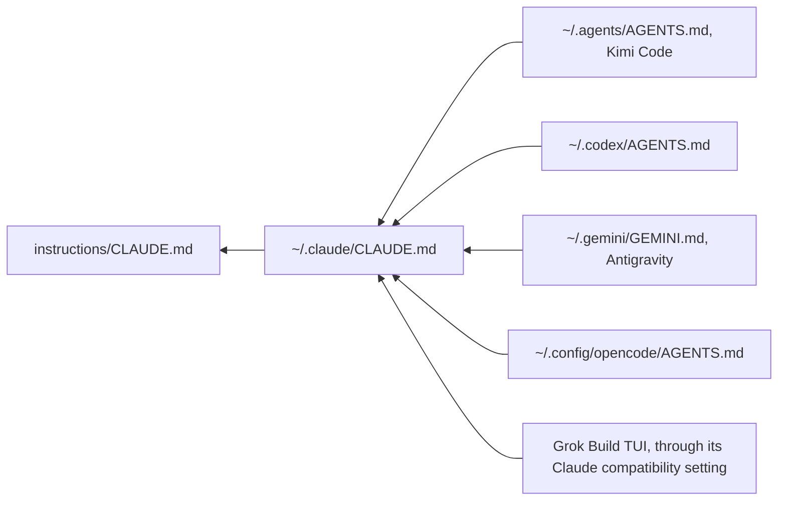

# Instructions

This directory holds [`CLAUDE.md`](CLAUDE.md), one global instruction file that every supported harness reads. Keeping a single file means a rule changed once takes effect in every harness.

## How each harness reads it

There is one real file. Every harness reaches it through a symbolic link, so there are no copies to fall out of date.



Links were chosen over generating one file per harness. Generated files could be trimmed for each harness, but they are one more thing that can drift. A link cannot.

Create the first link from a local clone:

```bash
mkdir -p "$HOME/.claude"
ln -s "$PWD/instructions/CLAUDE.md" "$HOME/.claude/CLAUDE.md"
```

The [new-machine setup guide](../guides/guide-new-machine-setup.md) covers the other harness links.

## Check the links

```bash
ls -l ~/.claude/CLAUDE.md ~/.agents/AGENTS.md ~/.codex/AGENTS.md \
      ~/.gemini/GEMINI.md ~/.config/opencode/AGENTS.md
```

Each path must resolve to `instructions/CLAUDE.md`. A broken link leaves a harness running with no instructions, and the harness does not warn you.

## Editing `CLAUDE.md`

- **A change applies to every harness.** Limit a rule to one harness only when it is specific to that harness, and label the section.
- **Use wording that is not specific to one harness.**
- **Leave out installer steps for individual harnesses.**
- **Watch the size.** Antigravity truncates any rule file over 24,000 bytes, and all its always-on rules share a 20,000-token budget ([rules docs](https://antigravity.google/docs/rules), checked 2026-11-17). Check with `wc -c instructions/CLAUDE.md` before committing a large addition.
- **Keep only lines that prevent mistakes.** For every line, ask whether removing it would cause the agent to make a mistake. If not, remove it.

## Writing rules

Edit [Reply behavior and tone](CLAUDE.md#reply-behavior-and-tone) directly in the toolkit. The shared brief owns these rules. Keep CopyDesk's installer pointed away from this file because it can append its own rules through the symbolic links.
