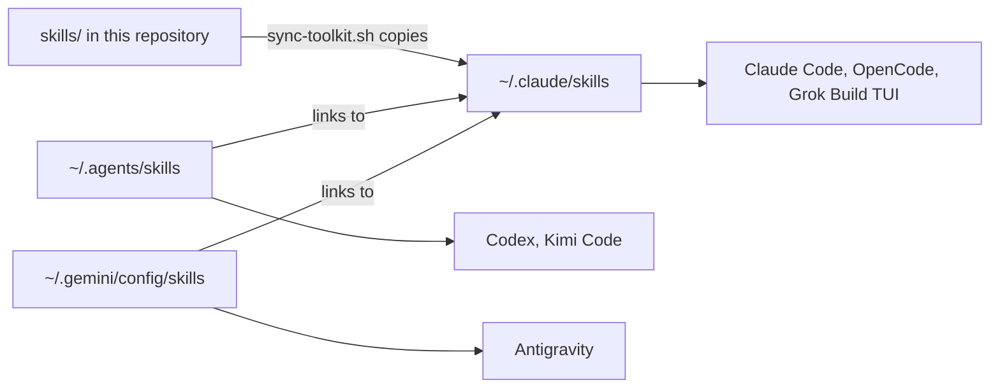

# Skills

Each directory holds one agent skill in the `SKILL.md` format that Claude Code and compatible harnesses load. Some skills also ship scripts, schemas, tests or reference files, so always install the complete directory unless the skill's README says otherwise.

## Catalog

| Skill | How to run it | What it does |
|---|---|---|
| [`briefing`](briefing/) | `/briefing` | Summarizes a project's current state from Git, GitHub, top-level files and its declared tracking records. Runs only when asked, not on follow-up questions. |
| [`learn`](learn/) | `/learn` | Explains a commit, pull request, file, folder, symbol, behavior or topic at the audience level and depth you choose |
| [`schedule-resume`](schedule-resume/) | `/schedule-resume` | Bundled skill with a shell helper that schedules an unattended session to resume later, using launchd on macOS or cron on Linux. Works with Claude Code, Antigravity, Codex and Kimi Code. |
| [`repo-standards`](repo-standards/) | `/repo-standards` | Checks, fixes or scaffolds a repository's governance files, workflows and branch protection from the house standard |
| [`oss-standards`](oss-standards/) | `/oss-standards` | Shortcut for `/repo-standards oss`. New automation should call `repo-standards` directly. |
| [`housekeeping`](housekeeping/) | `/housekeeping` | Compares local branches and worktrees with GitHub pull requests, and in `fix` mode removes only what a merge left behind |
| [`penmark-comments`](penmark-comments/) | Automatic, or on request | Reviews a local Markdown file and, once you choose where the output goes, can write validated Penmark inline comments |
| [`git-worktrees`](git-worktrees/) | Automatic | Sets the worktree location shared by all harnesses and the checks to run before changing branches |
| [`start-brainstorm`](start-brainstorm/) | `/start-brainstorm` | Challenges an idea, compares options, and presents a brainstorm for review before technical design |
| [`start-research`](start-research/) | `/start-research` | Investigates uncertainty before, within, or independently of other phases, with proportionate evidence and access |
| [`start-requirements`](start-requirements/) | `/start-requirements` | Defines accepted product scope or an optional brief or PRD |
| [`start-design`](start-design/) | `/start-design` | Writes a reviewable design from a reviewed brainstorm or clear brief |
| [`start-planning`](start-planning/) | `/start-planning` | Combines builder specifications and executable task planning from a usable design |
| [`start-debugging`](start-debugging/) | `/start-debugging` | Finds the root cause of a bug, failure or regression before any fix, with an investigate-only mode and a blameless incident review |
| [`start-implementation`](start-implementation/) | `/start-implementation` | Drives an approved plan, or work with an in-session plan from a design, issue, or clear request, with in-session planning when no plan document is needed |
| [`start-review`](start-review/) | `/start-review` | Coordinates applicable specialist review against original intent and integrated behavior |
| [`start-retrospective`](start-retrospective/) | `/start-retrospective` | Synthesizes lessons and evidence into owned process improvements |
| [`capture-meeting`](capture-meeting/) | `/capture-meeting` | Turns a meeting recording, notes and related files into a checked project record |
| [`externalize-deliverable`](externalize-deliverable/) | `/externalize-deliverable` | Makes a client-safe copy of an internal document, which a person must review before it is sent |
| [`tdd`](tdd/) | `/tdd`, or on request | Test-driven development as a red-to-green loop at seams agreed with you |
| [`receiving-code-review`](receiving-code-review/) | Automatic | Checks each review comment against the code before acting on it, and pushes back on wrong ones |
| [`research`](research/) | `/research` | Compatibility entry for the explicit legacy command; follows `start-research` |
| [`handoff`](handoff/) | `/handoff` | Writes a handoff document into the project's working-memory notes for the next session |

Each skill's README covers its arguments, dependencies, install steps and design decisions.

## Phase boundaries

Write a document only when it adds value: it records a decision worth keeping, needs review across people or sessions, or supports large, risky or complex work (several sessions, several agents, a step that cannot run twice, or progress to track). Other work stays in chat with a short design, an approval only for a real choice, and an in-session plan. The agent states its route in one line, asks when unsure, prefers the heavier route when unsure, and steps up when hidden complexity appears. A route the user picks wins after one stated risk. Invoke a phase explicitly or through a natural-language request for that work; an autonomous workflow may include several phases. A later session starts from its source, recorded run authority, and current repository. A clear request can itself be the source.

| Phase | Input | Output and checkpoint |
|---|---|---|
| `/start-brainstorm` | Idea or active brainstorm | Settled points, options, and open questions, presented for brainstorm review |
| `/start-research` | Question, uncertainty, or existing evidence | Findings, sources, gaps, and decision implications; a report only when useful |
| `/start-requirements` | Idea, research, brief, or request | Identified scope owner and intended outcomes; optional brief or PRD |
| `/start-design` | Accepted brief or PRD, reviewed exploration, research, or clear request | Short design in chat for bounded work, or a design file against the shared or project contract, presented for review |
| `/start-planning` | Approved design | Implementation plan, presented for plan review |
| `/start-implementation` | Authoritative plan or design, execution-ready issue, or clear request | In-session plan when no plan document is needed, then verified work at the authorized delivery milestone |
| `/start-review` | Artifact, change, or delivery scope | Findings and review evidence using applicable specialists; truthful review authority |
| `/start-retrospective` | Lessons, source changes, execution and review evidence | Process assessment and owned follow-ups, separate from readiness review |
| `/start-debugging` | Bug, failure, flaky or slow behaviour | Confirmed root cause, then a fix through `/start-implementation`, or a report in investigate-only mode |

Human review gates and a stop between phases are the default. An explicit full or partial autonomous workflow can authorize its included agent reviews and handoffs without another permission round at every phase. Preserve retained human gates and the requested endpoint. Record the run's authorization, scope, and stopping point in a durable project record the next session reads, using existing records rather than a new authorization form. Commit drafts too. Record review in `status` and `reviewed_by`: the accountable human's GitHub username, plus `(delegated to <model>, <harness>)` when that human did not read the document; an agent review is never a claim that the human personally reviewed the artifact. A phase-only request does not authorize subsequent phases.

Research, historically called discovery, can precede brainstorming or support any phase, including through spikes, and returns evidence and uncertainty to a question. It grants no authority by itself. Use existing review methods at the applicable checkpoints and for the integrated result. Native planning/task tools can hold an in-session plan; no fixed prose format is required.

Examples of valid routes, not an exhaustive list:

- A substantial feature or MVP: brainstorm, optional research, requirements when needed, design, durable plan, implementation, review.
- A bounded feature: a short design in chat, implementation with an in-session plan, review.
- A clear solution: design, optional durable plan, implementation, review.
- A bug with an unknown cause: debugging, then implementation of the fix with an in-session plan.
- A clear change, such as a documentation correction, dependency update, configuration change, fix, or improvement: implementation with an appropriate in-session plan, verification, and review. No design, plan, or issue document is required solely by category.

Requirements owns intended behavior and scope; design owns the technical solution; planning owns builder specifications, tasks, acceptance proof, dependencies, and integration. There is no mandatory intermediate spec document. Accepted scope can belong to a request, issue, brief in design, or separate PRD; identify one owner rather than duplicate it. Brainstorming can stop at exploration or produce several initiatives. Promotion follows user intent or included autonomous authority and does not automatically supersede useful rationale.

For substantial work, preserve stable consequential source references and inspect original product and architecture sources as well as the previous artifact. Account for preserved obligations, authorized changes, reasoned exclusions, and unresolved questions. Reconcile changed sources with affected downstream work and reviews. Keep scope, authority, evidence, progress, and next checkpoint visible through existing records. Lessons are captured during any phase; optional retrospectives synthesize them. Draft lessons do not count as unfinished delivery work.

Working-memory folders are `0-brainstorms/`, `1-research/`, `2-requirements/`, `3-design/`, `4-plans/`, `5-reviews/`, and `6-retros/`, with standalone lessons in `6-retros/lessons/<workstream>/`. Create directories only when used, discover project-native locations, and support legacy layouts during adoption. These numbers mandate no sequence.

A reviewed design may suffice for implementation without a separate plan file. Add a plan file when the document test calls for one. Applicable product decisions and architecture constraints remain in force on every route. Document readiness and authorization to implement are checked separately. A clear request authorizes its scope; an autonomous request can authorize several included phases and reviews. Neither invents authority for external effects beyond the request.

## Install one skill

Clone the repository, then copy the whole skill directory into the Claude Code skill directory:

```bash
skill_name=learn
mkdir -p "$HOME/.claude/skills/$skill_name"
cp -R "skills/$skill_name/." "$HOME/.claude/skills/$skill_name/"
```

Start a new session afterwards. Skills with a slash command appear in the harness's command or skill list. Skills that load automatically may not appear there.

## Synchronize every authored skill

The synchronizer copies every skill in this directory into one hub at `~/.claude/skills`, then links the other harnesses' skill directories to it. It also writes OpenCode slash-command wrappers and the OpenCode Mermaid plugin.

Preview the changes, then apply them:

```bash
./scripts/sync-toolkit.sh --dry-run --harness
./scripts/sync-toolkit.sh --harness
```

`skills/sync-skills.sh` still works, and forwards to `scripts/sync-toolkit.sh --harness`.



| Path | Role | Read by |
|---|---|---|
| `~/.claude/skills` | The hub. Holds real skill directories. | Claude Code, OpenCode, and Grok Build TUI through its Claude compatibility setting |
| `~/.agents/skills` | A link to the hub | Codex and Kimi Code |
| `~/.gemini/config/skills` | A link to the hub | Antigravity |
| `~/.codex/skills` | Codex's own bundled skills. Not linked to the hub. | Codex |

Antigravity's command-line tool also documents a separate directory, `~/.gemini/antigravity-cli/skills`. The synchronizer does not link it. Check whether skills appear there, and link it yourself only after looking at what it already contains. See [Google's skill locations](https://antigravity.google/docs/skills), checked 2026-09-22.

The [harness plugin parity guide](../guides/guide-harness-plugin-parity.md) covers each harness's discovery rules in more detail.

## Install a skill for one project

To make a skill part of one repository, copy it into that harness's project-level skill directory. For Claude Code that is `.claude/skills`:

```bash
skill_name=learn
mkdir -p ".claude/skills/$skill_name"
cp -R "skills/$skill_name/." ".claude/skills/$skill_name/"
```

Check the harness's precedence rules before committing a duplicate. Claude Code prefers enterprise skills over personal skills, and personal skills over project skills, according to the [official discovery rules](https://code.claude.com/docs/en/skills), checked 2026-09-22.

## CrossRev review skills

The `pr-review` and `pr-resolve` skills now live in the [CrossRev repository](https://github.com/carlosboeing/crossrev), with the tool that runs them. Install them from there:

```bash
npx skills@latest add carlosboeing/crossrev
```

To sync them from a local CrossRev checkout instead, add its skills directory to `EXTRA_SKILL_SOURCES` in your local sync configuration. See [`sync-toolkit.conf.example`](../scripts/sync-toolkit.conf.example).

## Adding a skill to this repository

- Put each skill in its own directory, `skills/<name>/`.
- `SKILL.md` is the file the harness loads.
- Put usage and maintenance notes for people in a `README.md` next to it.
- Keep a skill to a single file until it needs scripts, schemas, tests or reference files.
- List every external command or service the skill needs.

Every skill needs Git, Bash and `rsync` to install. Individual skill READMEs list anything extra, such as `gh`, `jq` or `ripgrep`.
