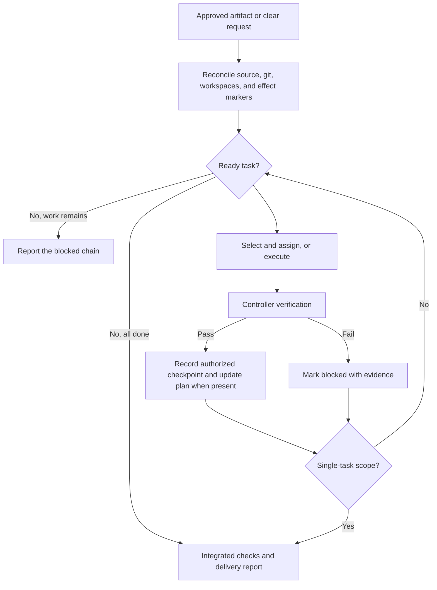

# start-implementation

Drives implementation from an approved plan, whole or by one task, an execution-ready design or issue, or a clear current request for work whose scope and acceptance can be established. Work with an in-session plan can start without a design or plan document. One controller runs the phase: it selects ready work, delegates where the harness supports it, verifies results, integrates, and records progress. It stops at the authorized delivery milestone.

## What it does

```
/start-implementation [plan-path] [task-id]
```

It also runs when you ask in plain words to implement a plan, resume interrupted work, or just fix something small. The path and task ID are optional. A clear request is used as the source. For plan-driven work without a path, the skill finds the current approved plan; without a task ID it drives the whole plan.



## Entry scopes

| Scope | What you supply | What it does | Where it stops |
|---|---|---|---|
| Whole plan | An approved plan path | Drives every dependency-ready task to the plan's authorized delivery milestone | At that milestone, or a halt condition |
| Single task | Plan path plus a task ID | Checks predecessors, runs that task, records its checkpoint | After the named task, even when more work is ready |
| In-session plan | A design, issue, or clear current request | Uses an existing plan if one exists; otherwise states the route in one line or asks when unsure, plans in session, and implements | At the authorized delivery point |

## Choosing documents

A plan file is for work that spans several sessions, involves several people or agents, has a step that cannot run twice, or needs a lasting progress record. Clear small work gets a one-line route statement and an in-session plan; when unsure, the skill asks and recommends the plan file. A route you pick wins after one stated risk. A reviewed design may already provide enough detail for implementation with an in-session plan using the harness's native plan/task tools or another proportionate method. The readiness questions are checks, not a required response template. The skill proceeds after that preflight when the implementation request is clear and no consequential decision remains open; it does not add another approval round.

Creating an issue or PR is not an entry requirement. Applicable product decisions and architecture constraints still hold on the shortest route. Verify the source revision, review evidence, and actual authority. An explicit autonomous run can delegate review and progression; preserve retained human gates and never mislabel agent review as personal human approval. A reviewed source is identified by the commit that records its review; a committed draft is not reviewed, and an uncommitted edit never becomes the reviewed revision.

## Delivery states

The report keeps verified local work, committed work, PR review, merge, and rollout apart. A branch SHA is never presented as a merge SHA, and no state implies permission for the next one.

## What it will not do

- Write or revise a durable design or plan document. Brief in-session planning is part of implementation.
- Infer permission to push, open a PR, merge, or deploy.
- Repeat an external effect to repair a checkbox.
- Let a worker write shared state or self-merge.
- Claim a delegation it did not make.

## Install

See [Install one skill](../README.md#install-one-skill) in the skills catalog, or run `scripts/sync-toolkit.sh --harness` to sync every skill.

## Design notes

- The five readiness questions live in the skill so it stands alone: no separate implementation guide is needed to run work with an in-session plan.
- When a durable plan exists, progress follows the two-commit sequence: the code commit first, then a plan commit that ticks the task and records the code SHA. One controller owns plan writes.
- Delegation is checked against the live harness at run time. When no worker facility exists, the same tasks run serially instead of faking one.

## Phase scope and autonomy

Defaults and autonomous runs follow [Phase boundaries](../README.md#phase-boundaries).
